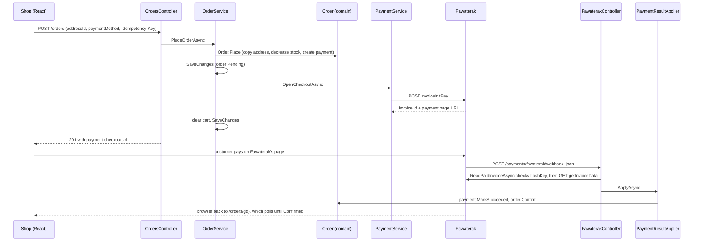

# Checkout flow: follow the code

This walks one order through the code in the order things happen, from the click on *Pay* to a confirmed (or
cancelled) order. Open each file next to this page and read the method named in bold. To run the same journey
by hand, send the requests in `src/Audiophile.API/checkout-flow.http` from top to bottom.

## 1. The shop sends the order

`client/src/pages/Checkout.jsx` saves or reuses the address, then sends `POST /orders` with
`{ addressId, paymentMethod }` and a new `Idempotency-Key` header. The items are not in the request: they come
from the customer's cart on the server, and the prices come from the database.

## 2. The controller checks the header

`src/Audiophile.API/Controllers/OrdersController.cs` → **`Place`**. A missing or too long `Idempotency-Key`
is a 400. Otherwise it calls `OrderService.PlaceOrderAsync` and answers 201 for a new order or 200 for a
repeated key.

## 3. The service places the order

`src/Audiophile.Application/Orders/OrderService.cs`:

- **`PlaceOrderAsync`** only wraps the work in **`RetryOnStockConflictAsync`** (see step 4).
- **`TryPlaceOrderAsync`** does the work:
  1. The same `Idempotency-Key` from the same customer returns the order it already created, so a double
     click or a retried request never makes two orders.
  2. It loads the address (only the customer's own, active ones) and the cart with its products. An empty
     cart is a 409.
  3. **`Order.Place`** builds the order (step 5).
  4. **Cash on delivery:** `order.Confirm()`, empty the cart, one `SaveChanges`. Done.
  5. **Card:** `SaveChanges` first, so the order exists before Fawaterak can call the webhook. Then
     `PaymentService.OpenCheckoutAsync` (step 6), empty the cart, save again.
  6. If Fawaterak fails, nobody can pay, so `order.Cancel()` gives the stock back, the payment becomes Failed,
     and the error goes out as a 502 or 504.

## 4. Two customers buying the last unit

`Product` has a hidden `Version` column mapped to PostgreSQL's `xmin`
(`Persistence/Configurations/ProductConfiguration.cs`). When two requests read the same stock and both save,
the second save matches no row and EF throws `DbUpdateConcurrencyException`.

**`RetryOnStockConflictAsync`** catches it once, clears the change tracker so nothing stale is kept, and runs
the whole checkout again. The second run reads the new stock: if the unit is gone, `DecreaseStock` refuses and
the customer gets a 409 "not enough stock". A second conflict in a row also becomes a 409, through
`GlobalExceptionHandler`.

Tests: `StockConcurrencyTests` proves `xmin` refuses the second write, and
`OrderApiTests.Two_customers_buying_the_last_unit_at_once_get_exactly_one_order` sends both checkouts at once.

## 5. The domain keeps the order valid

`src/Audiophile.Domain/Entities/Order.cs` → **`Place`**:

- copies the address into the order's `Shipping*` columns, so editing the address later does not change it;
- for each product: refuses one that is no longer sold, calls `product.DecreaseStock` (which refuses to go
  below zero), and adds an `OrderItem` with the name and price copied;
- works out the subtotal, the shipping fee (`ShippingPolicy`: 50 EGP, free from 5,000) and the total;
- creates the `Payment` with exactly the order total.

`Confirm`, `Cancel` and `ChangeStatus` only allow the moves in `AllowedNextStatuses`.

## 6. Opening the Fawaterak page

`src/Audiophile.Application/Payments/PaymentService.cs` → **`OpenCheckoutAsync`** reads the customer's
email and calls `IFawaterakGateway.CreateInvoiceAsync`, then saves the invoice id, invoice key and payment page
URL on the payment with `LinkToProvider`.

`src/Audiophile.Infrastructure/Payments/Fawaterak/FawaterakGateway.cs` → **`CreateInvoiceAsync`** builds
Fawaterak's JSON from the order (one line per product, shipping as its own line, our order id in `payLoad`, the
return and webhook URLs) and sends `POST invoiceInitPay` with the API key as a bearer token.
**`SendAsync`** turns every failure into a `GatewayException` (502) or a `GatewayTimeoutException` (504).

## 7. The customer pays

The shop sends the browser to `payment.checkoutUrl`. The card is typed on Fawaterak's page, never on ours.
Afterwards Fawaterak redirects the browser to `FawaterakController.Return`, which forwards to
`/orders?orderId=…`. That redirect proves nothing, so `client/src/pages/OrderDetail.jsx` asks the API every
3 seconds until the order changes.

## 8. The webhook confirms the payment

`src/Audiophile.API/Controllers/FawaterakController.cs` → **`Webhook`** reads the raw body and calls:

- `FawaterakGateway` → **`ReadPaidInvoiceAsync`**: anything that is not a *paid* notice is acknowledged and
  ignored. For a paid one it recomputes the `hashKey` with the vendor key (`FawaterakHash`). A wrong hash
  throws, which answers 401. The hash does not cover the amount, so it then asks Fawaterak
  (`GET getInvoiceData`) for the real total.
- `src/Audiophile.Application/Payments/PaymentResultApplier.cs` → **`ApplyAsync`**: stores the event (a
  unique index makes a repeated webhook a `Duplicate`), finds the order, and in **`ApplyToOrder`**:
  not paid yet → nothing; wrong amount → `AmountMismatch`; already paid → `Duplicate`; order already
  cancelled → `NeedsManualRefund`; otherwise `payment.MarkSucceeded` and `order.Confirm()`.

## 9. Cancelling

`OrdersController.Cancel` → `OrderService` → **`CancelOrderAsync`**: only the customer's own order (someone
else's is a 404), only while the status allows it, and never once a card payment has succeeded (409 "contact
support", because refunds are done in the Fawaterak dashboard). `order.Cancel()` puts the stock back and
fails a pending payment. It uses the same retry as checkout, because returning stock also writes `Product`.

The *Cancel order* button on `OrderDetail.jsx` uses the same rule to decide when to show itself.

## 10. When the webhook never arrives

- **Sync**, for admins: `POST /orders/{id}/payment/sync` → `PaymentService.SyncWithGatewayAsync` asks
  Fawaterak for the invoice and sends the answer through the same `PaymentResultApplier`.
- **Expiry**, every 5 minutes: `PaymentExpiryWorker` → `PaymentService.ExpireUnpaidOrdersAsync` finds card
  payments still pending after 30 minutes, syncs each one first, and cancels the ones that are really unpaid.
