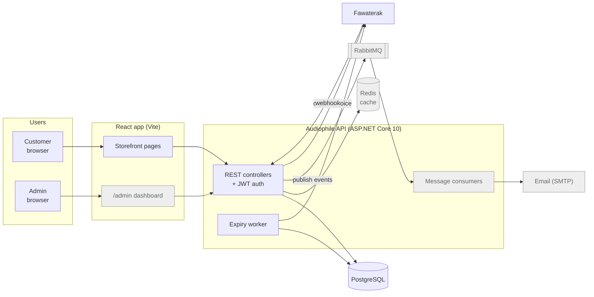
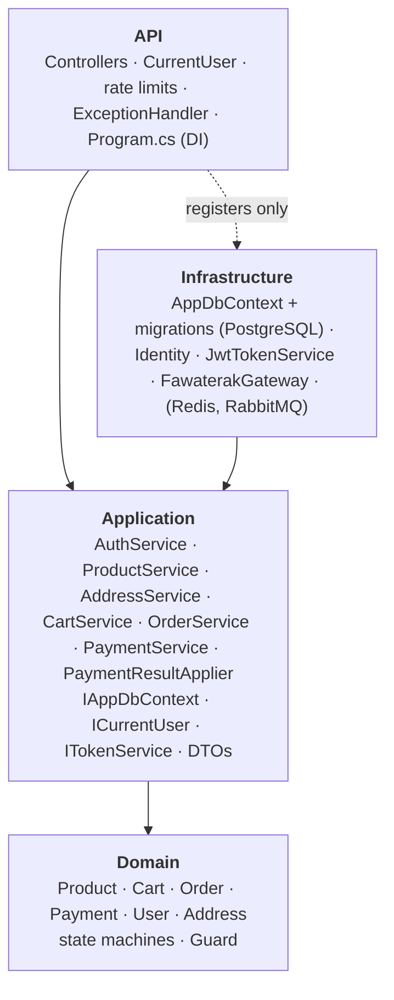
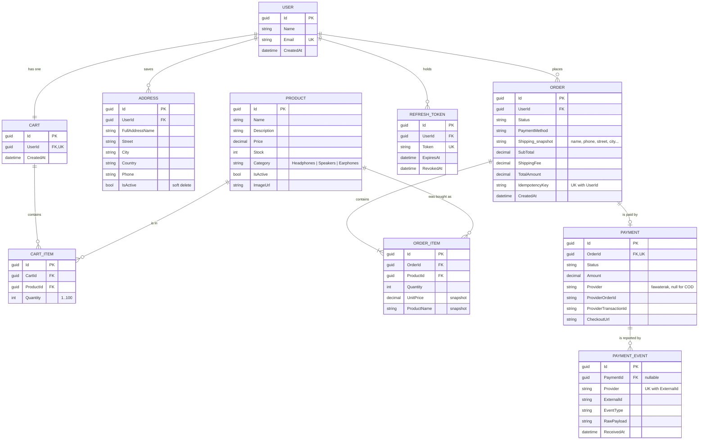
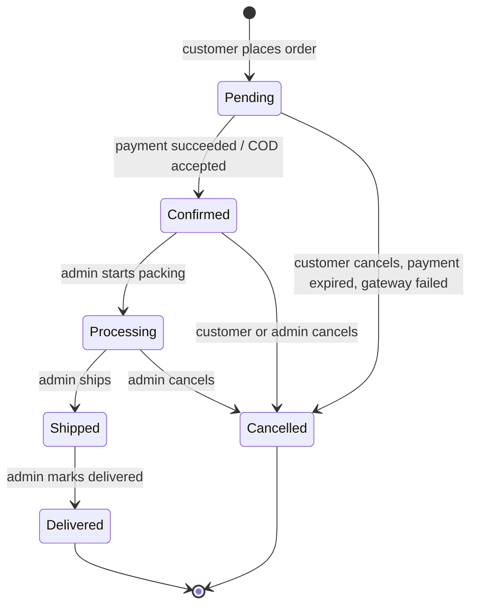
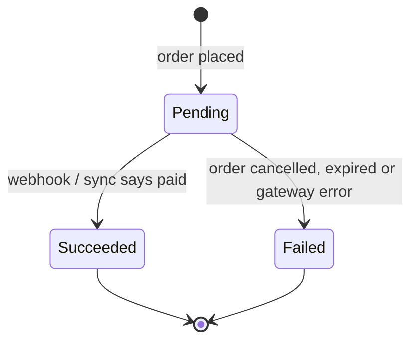
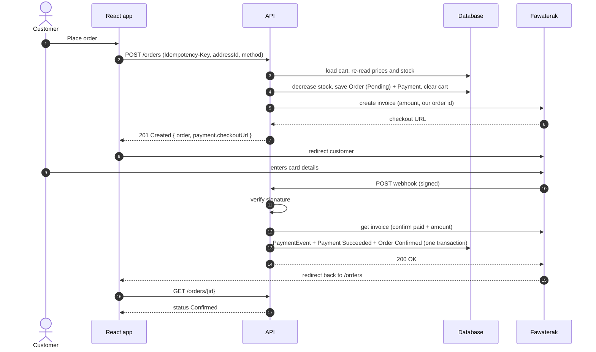
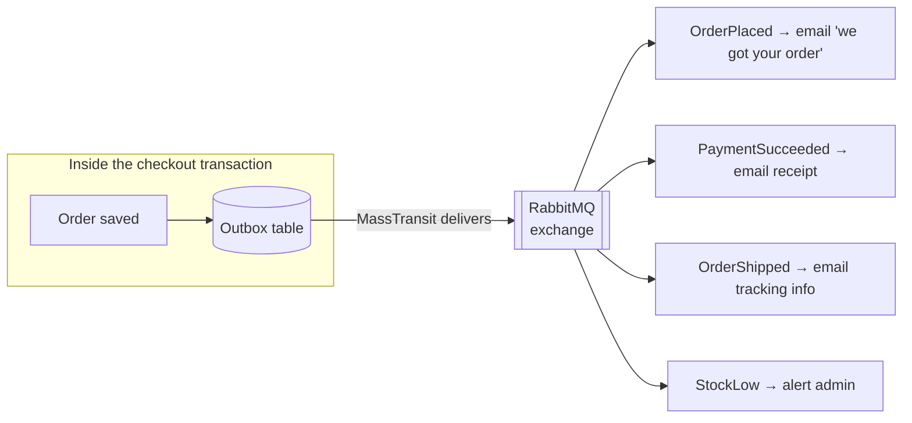
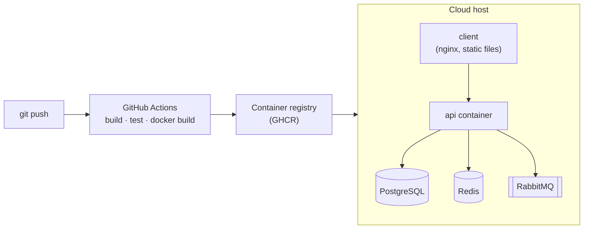

# Diagrams

All diagrams are [Mermaid](https://mermaid.js.org), so GitHub renders them and they stay
editable as text. VS Code shows them with the *Markdown Preview Mermaid Support* extension.

1. [System architecture (target)](#1-system-architecture-target)
2. [Clean Architecture layers](#2-clean-architecture-layers)
3. [Entity-relationship diagram](#3-entity-relationship-diagram)
4. [Order status](#order-status)
5. [Payment status](#payment-status)
6. [Checkout and payment sequence](#6-checkout-and-payment-sequence)
7. [Pluggable payment gateways (Strategy pattern)](#7-pluggable-payment-gateways-strategy-pattern)
8. [Events and messaging](#8-events-and-messaging)
9. [Deployment](#9-deployment)

---

## 1. System architecture (target)

What the finished system looks like. Grey items are not built yet.



## 2. Clean Architecture layers



Arrows mean "depends on". Nothing points outward from `Domain`.

## 3. Entity-relationship diagram

Only the important columns are shown. `User` also has every ASP.NET Identity column
(password hash, lockout, …), and roles live in Identity's `AspNetRoles` / `AspNetUserRoles` tables.



**How to read it:** `||--o{` means "one to zero-or-many", `||--||` means "exactly one to exactly one",
and `||--o|` means "one to zero-or-one".

**Things worth explaining in an interview:**
- **Unique `(CartId, ProductId)`** → a product appears once per cart; the database enforces it, not only the code.
- **Unique `(UserId, IdempotencyKey)`** → a retried checkout can never create two orders.
- **Unique `(Provider, ExternalId)`** on `PAYMENT_EVENT` → a webhook delivered twice is applied once.
- **Snapshots on `ORDER` / `ORDER_ITEM`** → order history doesn't change when prices or addresses do.
- **`ORDER_ITEM → PRODUCT` is `Restrict`** → you can't delete a product that has been sold; deactivate it instead.

## Order status



Every cancellation puts the stock back (`Order.Cancel`). The table lives in `Order.AllowedNextStatuses`.

## Payment status



## 6. Checkout and payment sequence

The flow for a card payment once Phases 1–2 are done (checkout from the cart, pluggable gateway).



For **cash on delivery**, steps 5–15 are skipped: the order is confirmed straight away.

## 7. Pluggable payment gateways (Strategy pattern)

The target design for "add any gateway later". `OrderService` only knows `IPaymentGateway`;
each gateway is one class in `Infrastructure`. Adding Paymob or Stripe means adding one class
and one line of DI, with no changes to checkout.

```mermaid
classDiagram
    direction LR
    class IPaymentGateway {
        <<interface>>
        +string Name
        +bool Supports(PaymentMethod)
        +CreateCheckoutAsync(CheckoutRequest) CheckoutSession
        +GetTransactionAsync(string id) GatewayTransaction
        +ParseWebhookAsync(string body, headers) GatewayCallback
    }
    class IPaymentGatewayResolver {
        <<interface>>
        +ForMethod(PaymentMethod) IPaymentGateway
        +ByName(string) IPaymentGateway
    }
    class FawaterakGateway
    class PaymobGateway {
        future
    }
    class StripeGateway {
        future
    }
    class OrderService
    class PaymentResultApplier
    class PaymentsController {
        POST /payments/{provider}/webhook
    }

    IPaymentGateway <|.. FawaterakGateway
    IPaymentGateway <|.. PaymobGateway
    IPaymentGateway <|.. StripeGateway
    OrderService --> IPaymentGatewayResolver
    PaymentsController --> IPaymentGatewayResolver
    PaymentsController --> PaymentResultApplier
    IPaymentGatewayResolver --> IPaymentGateway
```

- **Strategy** = interchangeable algorithms behind one interface (`IPaymentGateway`).
- **Adapter** = each implementation translates one provider's API into our types.
- **Resolver (a small factory)** = picks the strategy from configuration or from the URL's `{provider}`.
  .NET 8+ *keyed services* (`AddKeyedScoped<IPaymentGateway, FawaterakGateway>("fawaterak")`) make it a few lines.

## 8. Events and messaging

Phase 6. Things that don't have to happen *inside* the request (emails, low-stock alerts, cache
invalidation) are published as events and handled later by consumers.



**Why an outbox:** if we saved the order and then published to RabbitMQ in two steps, a crash in
between would lose the event (or publish an event for an order that was never saved). The outbox
writes the event to the same database transaction as the order, and a background sender
forwards it. *"At-least-once delivery, made safe by idempotent consumers"* is the interview sentence.

## 9. Deployment

Phase 7. One `docker compose up` runs everything locally; the same images go to the cloud.


