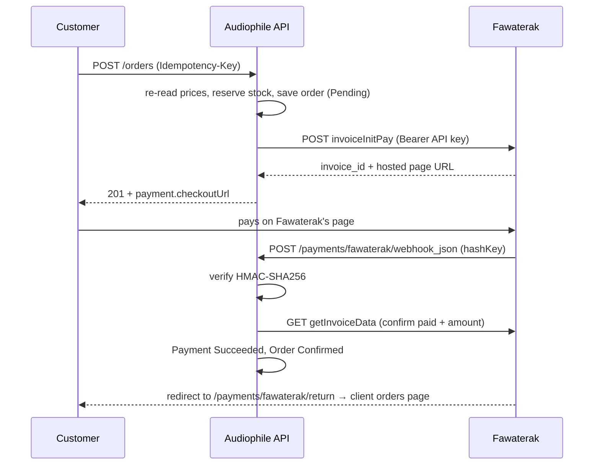

# Fawaterak integration

Checkout through [Fawaterak](https://fawaterak-api.readme.io) (Egypt): **card only**, plus cash on
delivery with no gateway. Wallet and Fawry/Aman codes were removed on 2026-10-18 to keep the flow small
(Phase 2 can add them back as new strategies). Switched back on 2026-10-18, with checkout now placed from the cart. To follow the code step by step,
read [`checkout-flow.md`](checkout-flow.md); to try it, send the requests in `src/Audiophile.API/checkout-flow.http`.

## The flow



1. **Place the order.** Prices come from the database, stock is reserved, the order is saved as
   Pending *before* calling Fawaterak so a fast webhook finds it.
2. **Create the invoice.** `invoiceInitPay` with the order total, our order id in `payLoad`, the
   return URLs and our webhook URL. `redirectOption: true` makes every method return a hosted page.
3. **Customer pays on Fawaterak's page.** Card data never touches our server.
4. **Webhook confirms.** The `hashKey` is HMAC-SHA256 of
   `InvoiceId=…&InvoiceKey=…&PaymentMethod=…` with the vendor key (= the API key). It does not
   cover the amount, so after verifying it we call `getInvoiceData` and confirm paid + amount.
5. **Redirect** lands the customer on My orders, which shows our own record. It never changes state.

Safety nets: `POST /orders/{id}/payment/sync` asks Fawaterak directly, and an expiry job
(every 5 min) asks Fawaterak before cancelling orders left unpaid for 30 minutes.

## Where things live

| Concern | File |
|---|---|
| Order rules: place (reserves stock, creates the payment), confirm, cancel (returns stock) | `src/Audiophile.Domain/Entities/Order.cs` |
| Payment: Pending → Succeeded or Failed | `src/Audiophile.Domain/Entities/Payment.cs` |
| Webhook audit log + de-duplication | `src/Audiophile.Domain/Entities/PaymentEvent.cs` |
| Gateway interface (Fawaterak only) | `src/Audiophile.Application/Payments/IFawaterakGateway.cs` |
| Placing and reading orders | `src/Audiophile.Application/Orders/OrderService.cs` |
| Open the Fawaterak page, sync, expiry, payment events | `src/Audiophile.Application/Payments/PaymentService.cs` |
| The one place a gateway report changes state | `src/Audiophile.Application/Payments/PaymentResultApplier.cs` |
| Fawaterak adapter | `src/Audiophile.Infrastructure/Payments/Fawaterak/FawaterakGateway.cs` |
| Webhook signature | `src/Audiophile.Infrastructure/Payments/Fawaterak/FawaterakHash.cs` |
| Timeouts and GET-only retries | `src/Audiophile.Infrastructure/DependencyInjection.cs` |
| Expiry job | `src/Audiophile.Infrastructure/Payments/PaymentExpiryWorker.cs` |
| Webhook + return endpoints | `src/Audiophile.API/Controllers/FawaterakController.cs` |

## Running it

```powershell
# secrets (staging dashboard → Integration)
cd src\Audiophile.API
dotnet user-secrets set "Fawaterak:ApiKey"    "..."
dotnet user-secrets set "Fawaterak:VendorKey" "..."          # same value as the API key
dotnet user-secrets set "Fawaterak:CardPaymentMethodId"   "2"   # from GET getPaymentmethods
dotnet user-secrets set "Fawaterak:PublicBaseUrl" "https://<your-ngrok-domain>"

# terminal 1: the API
dotnet run --project src\Audiophile.API --launch-profile http    # http://localhost:5040
# terminal 2: the shop; Vite forwards /api and /payments to the API (client/vite.config.js)
cd client; npm run dev                                            # http://localhost:5173
# terminal 3: the tunnel goes to the SHOP's port, not the API's
ngrok http 5173 --url=https://<your-ngrok-domain>
```

Why port 5173: one public URL then serves both the shop and `/payments/fawaterak/*`, which Vite passes to the
API. Fawaterak's webhook and the customer's return trip both arrive through it.

The test in the browser:
1. Open **http://localhost:5173** (shop on localhost: your login is stored for that address, and the return
   redirect goes back to it through `Fawaterak:ClientReturnUrl`).
2. Create an account → add a product → Checkout → **Card** → *Continue & Pay*.
3. Pay on Fawaterak's page with `5123450000000008` · `12/26` · CVV `100`.
4. ngrok's free plan may show a "You are about to visit…" page on the way back: click *Visit Site*.
5. You land on `/orders/<id>`: "Confirming your payment…", then **Thank you for your order** when the webhook
   arrives (the page asks the API every 3 seconds).

The ngrok inspector (`http://127.0.0.1:4040`) shows every webhook and our response.

## Learned on the first real payment

- Fawaterak rejects any request without `Content-Type`, GETs included. The adapter always sends it.
- A failed webhook (non-2xx) is retried by Fawaterak about 40 seconds later.
- `pay_load` comes back as a JSON string; the parser accepts string or object.
- `paidAmount` is in the webhook but outside the signature, so the lookup stays the source of truth.
- There is no public refund API; refunds are made in the dashboard. The refund webhook is unsigned
  and is logged, never applied.

## Known gaps

- Fawaterak is still the only gateway, called through `IFawaterakGateway`. Roadmap Phase 2 makes it pluggable.
- The return URL goes to `Fawaterak:ClientReturnUrl` (the React orders page), which doesn't exist until Phase 4.
- No automated tests for the gateway yet (Phase 2: a `FakePaymentGateway`).
