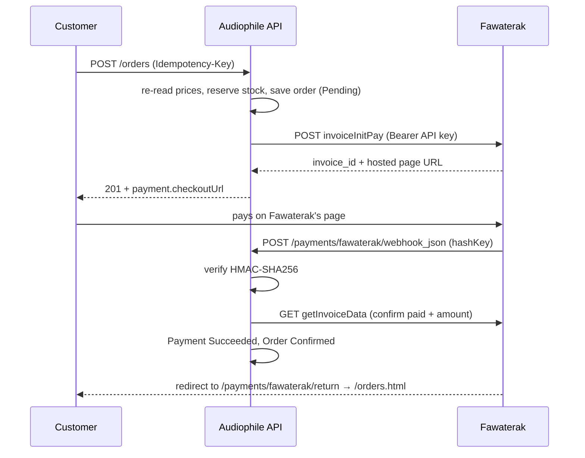

# Fawaterak integration

Checkout through [Fawaterak](https://fawaterak-api.readme.io) (Egypt): card, mobile wallet and
cash-outlet codes (Fawry; Aman when enabled on the account), plus cash on delivery with no
gateway. Currently **switched off** in code while checkout is rebuilt (see roadmap Phase 2).

## The flow



1. **Place the order.** Prices come from the database, stock is reserved, the order is saved as
   Pending *before* calling Fawaterak so a fast webhook finds it.
2. **Create the invoice.** `invoiceInitPay` with the order total, our order id in `payLoad`, the
   return URLs and our webhook URL. `redirectOption: true` makes every method return a hosted page.
3. **Customer pays on Fawaterak's page.** Card data never touches our server.
4. **Webhook confirms.** The `hashKey` is HMAC-SHA256 of
   `InvoiceId=…&InvoiceKey=…&PaymentMethod=…` with the vendor key (= the API key). It does not
   cover the amount, so after verifying it we call `getInvoiceData` and confirm paid + amount.
5. **Redirect** lands the customer on My orders, which shows our own record. It never changes state.

Safety nets: `POST /orders/{id}/payment/sync` asks Fawaterak directly, and an expiry job
(every 5 min) asks Fawaterak before cancelling unpaid orders (30 min card/wallet, 48 h cash codes).

## Where things live

| Concern | File |
|---|---|
| Payment state machine | `src/Audiophile.Domain/Entities/Payment.cs` |
| Webhook audit log + de-duplication | `src/Audiophile.Domain/Entities/PaymentEvent.cs` |
| Gateway interface (Fawaterak only) | `src/Audiophile.Application/Payments/IFawaterakGateway.cs` |
| Checkout, refund, void, sync, expiry | `src/Audiophile.Application/Orders/OrderService.cs` |
| The one place a gateway report changes state | `src/Audiophile.Application/Payments/PaymentResultApplier.cs` |
| Fawaterak adapter | `src/Audiophile.Infrastructure/Payments/Fawaterak/FawaterakGateway.cs` |
| Webhook signature | `src/Audiophile.Infrastructure/Payments/Fawaterak/FawaterakHash.cs` |
| Timeouts, GET-only retries, circuit breaker | `src/Audiophile.Infrastructure/DependencyInjection.cs` |
| Expiry job | `src/Audiophile.Infrastructure/Payments/PaymentExpiryWorker.cs` |
| Webhook + return endpoints | `src/Audiophile.API/Controllers/FawaterakController.cs` |

## Running it

```powershell
# secrets (staging dashboard → Integration)
cd src\Audiophile.API
dotnet user-secrets set "Fawaterak:ApiKey"    "..."
dotnet user-secrets set "Fawaterak:VendorKey" "..."          # same value as the API key
dotnet user-secrets set "Fawaterak:CardPaymentMethodId"   "2"   # from GET getPaymentmethods
dotnet user-secrets set "Fawaterak:KioskPaymentMethodId"  "3"   # Fawry
dotnet user-secrets set "Fawaterak:WalletPaymentMethodId" "4"
dotnet user-secrets set "Fawaterak:PublicBaseUrl" "https://<your-ngrok-domain>"

# terminal 1
dotnet run --project src\Audiophile.API --launch-profile http    # http://localhost:5040
# terminal 2
ngrok http 5040
```

Open the ngrok URL, add a product, pay with test card `5123450000000008` · `12/26` · CVV `100`.
The ngrok inspector (`http://127.0.0.1:4040`) shows every webhook and our response.

## Learned on the first real payment

- Fawaterak rejects any request without `Content-Type`, GETs included. The adapter always sends it.
- A failed webhook (non-2xx) is retried by Fawaterak about 40 seconds later.
- `pay_load` comes back as a JSON string; the parser accepts string or object.
- `paidAmount` is in the webhook but outside the signature, so the lookup stays the source of truth.
- There is no public refund API; refunds are made in the dashboard. The refund webhook is unsigned
  and is logged, never applied.

## Known gaps

- The payment code is switched off (`// PAYMENT GATEWAY (off)`) until roadmap Phase 2 makes the gateway pluggable.
- The return URL still points at the removed `/orders.html` page; Phase 2 points it at the React client's orders page.
- The sync and events endpoints must be admin-only when they come back.
- No concurrency token on stock yet (roadmap Phase 1).
- Wallet and Fawry can't be paid in staging; Aman isn't enabled on the staging account.
