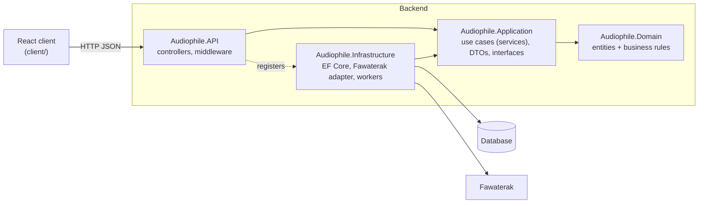

# Audiophile — project overview (revision notes)

Read this first when you come back to the project. It covers what the system is, what is
already built, how the code is organised and why. The other documents go deeper:

| Document | What it is for |
|---|---|
| [`roadmap.md`](roadmap.md) | **The plan.** Phases, tasks, where to start, the Git workflow, the testing track |
| [`use-cases.md`](use-cases.md) | Who uses the system and what they can do |
| [`diagrams.md`](diagrams.md) | Architecture, entity-relationship diagram, state machines, sequence diagrams |
| [`database.md`](database.md) | PostgreSQL locally and on Neon, connection strings, migrations |
| [`api.md`](api.md) | Every endpoint: access, bodies, status codes, auth rules, configuration keys |
| [`changelog.md`](changelog.md) | What changed and why, by date |
| [`fawaterak-integration.md`](fawaterak-integration.md) | The payment integration in detail, plus what the first real payment taught us |
| [`build-plan.md`](build-plan.md) | The original long plan. Superseded by `roadmap.md`, but its decision log (D-01 … D-04) still applies |

---

## 1. What this is

A full-stack e-commerce store for audio gear (headphones, speakers, earphones):

- **Backend:** ASP.NET Core 10 Web API, Clean Architecture, EF Core.
- **Frontend:** React 18 + Vite + Tailwind (`client/`).
- **Payments:** Fawaterak (Egypt): card, mobile wallet, Fawry/Aman cash codes, plus cash on delivery.

The goal is a portfolio project that is **scalable, maintainable, functional and reliable**,
with a system design you can explain end to end in an interview.

## 2. Where things stand (2026-10-15)

| Area | State | Notes |
|---|---|---|
| Domain model | ✅ Done | Rich entities with their rules inside: `Product`, `Cart`, `Order`, `Payment`, `PaymentEvent`, `User`, `Address`, `RefreshToken` |
| Database | ✅ PostgreSQL + migrations | Local PostgreSQL 18 (or Docker), Neon in production; `InitialCreate` migration with `jsonb`, check constraints and seeded roles/products. See [`database.md`](database.md) |
| Authentication | ✅ Done | Identity + JWT: register, login (with lockout), refresh with rotation and reuse detection, logout, `me`. Admin account from configuration |
| Products API | ✅ Done | List with search, category, price range and paging; get by id; admin create / update / deactivate |
| Addresses API | ✅ Done | Customer's own addresses: list, get, create, update, soft delete |
| Cart API | ✅ Done, **not committed** | Per signed-in user |
| Orders API | 🟡 Partial | Places an order from items sent by the client, **not from the cart yet**; no cancel. List and get work |
| Fawaterak payments | ⏸️ Built, then **switched off** | Commented out (`// PAYMENT GATEWAY (off)`), so only cash on delivery works |
| Webhooks, idempotency, expiry job | ✅ Built (switched off with payments) | `PaymentResultApplier`, `PaymentEvent` unique index, `PaymentExpiryWorker` |
| Stock concurrency | ❌ Not started | Two buyers of the last unit can both succeed until the `xmin` token lands (roadmap Phase 1) |
| React client | 🟡 UI only | Reads products from a static `data.json`; no API calls |
| Admin dashboard | ❌ Not started | The admin API endpoints for products exist |
| Caching / messaging | ❌ Not started | |
| Tests | 🟢 33 passing | Unit tests (domain, payments, cart) + 8 HTTP integration tests (auth, roles, ownership) |
| Docker / CI / deploy | 🟡 Started | `docker-compose.yml` runs PostgreSQL; no API image, CI or deploy yet |
| GitHub | ❌ No remote yet | Local repo only; most of this work is uncommitted |

**Ported from the original repo (`nourokbi/audiophile`) on 2026-10-15:** auth, addresses, product CRUD,
PostgreSQL with `jsonb` and check constraints, rate limiting and CORS, rebuilt for the four layers and
Identity. Not ported: `Coupon` (deferred, see `build-plan.md`). The `wwwroot` demo storefront was removed
because it had no login; the React client replaces it in Phase 4.

## 3. The architecture in one picture

**The one rule:** dependencies point *inward*. `Domain` knows nothing. `Application` knows only
`Domain`. `Infrastructure` implements interfaces that `Application` declares (`IAppDbContext`, the
gateway interface). `API` wires everything together and references `Infrastructure` only to register it.

**Why this matters for an interview:** you can swap the database, or Fawaterak for
Paymob, by changing `Infrastructure` only. The business rules never move.

## 4. How one request flows

`POST /cart/items { productId, quantity }`

1. **API** — `CartController.AddItem` receives the JSON and calls `CartService.AddItemAsync(userId, request)`.
2. **Application** — `CartService` loads the product and the cart through `IAppDbContext` and checks stock.
3. **Domain** — `cart.AddItem(productId, quantity)` enforces the rules: one line per product, quantity 1–100.
4. **Infrastructure** — `SaveChangesAsync` writes it to the database.
5. **Errors** — a rule violation throws, and `GlobalExceptionHandler` turns it into a
   `ProblemDetails` response (400 / 404 / 409), never a stack trace.

## 5. Design patterns already in the code (your talking points)

| Pattern | Where | Why it is there |
|---|---|---|
| **Aggregate root** (DDD) | `Cart` owns `CartItem`; `Order` owns `OrderItem` and `Payment` | Rules like "one line per product" can't be bypassed, because only the root can change its children |
| **State machine** | `Order.AllowedTransitions`, `Payment.AllowedTransitions` | Illegal moves (e.g. Delivered → Pending) are impossible, not just discouraged |
| **Factory method** | `Order.Place(...)`, `User.Create(...)`, `OrderLine.FromProduct(...)` | One controlled way to create a valid object |
| **Value object** | `ShippingDetails`, `OrderLine` | Immutable snapshots: editing an address never rewrites an old order |
| **Guard clauses** | `Domain/Common/Guard.cs` | Every entity validates input the same way |
| **Adapter** | `FawaterakGateway` | Translates Fawaterak's HTTP API into our own types |
| **Strategy** *(to restore)* | `IPaymentGateway` + resolver | Plug in any gateway; see roadmap Phase 2 |
| **Idempotency key** | `Order.IdempotencyKey` + unique index | A double-clicked "Pay" button creates one order, not two |
| **Idempotent consumer / inbox** | `PaymentEvent` unique `(Provider, ExternalId)` | A webhook delivered twice is applied once |
| **Snapshot** | Price, name and image copied onto `OrderItem` | Changing a product's price later doesn't change past orders |
| **Retry + circuit breaker** | `AddStandardResilienceHandler` (Polly) | A slow or failing gateway fails fast instead of hanging every request |
| **Background worker** | `PaymentExpiryWorker` | Releases stock held by unpaid orders |
| **Token rotation + reuse detection** | `AuthService.RefreshAsync` | A stolen refresh token works at most once; using an old one ends every session |
| **Rate limiting** | `RateLimitPolicies` | Login 10/min and register 5/hour per IP, so passwords can't be brute-forced |
| **Options pattern** | `FawaterakOptions` | Typed configuration; secrets kept outside the repo |

Coming in later phases: **cache-aside** (Redis), **publish/subscribe** and the
**transactional outbox** (RabbitMQ + MassTransit), and **optimistic concurrency** on stock.

## 6. Key decisions so far

- **D-01 / D-02** — ASP.NET Core Identity owns users, passwords and roles (`User : IdentityUser<Guid>`).
- **PostgreSQL everywhere** — a local install (or Docker) in development, Neon in production, migrations applied as a deploy step. Tests use SQLite only until Testcontainers lands.
- **Refresh tokens stored as SHA-256 hashes** — a database leak can't be used to sign in.
- **Fixed data in `HasData`, secrets at startup** — roles and sample products are part of the migration; the admin account is created from configuration because its password is a secret.
- **Prices are never trusted from the client.** Checkout re-reads them from the database.
- **Order saved before calling the gateway**, because the webhook can arrive within seconds and must find the order.
- **Webhook signature verified *and* invoice re-checked**, because Fawaterak's `hashKey` doesn't cover the amount.
- **Never cancel on an unknown outcome.** The expiry job asks Fawaterak before cancelling an unpaid order.
- **Payments temporarily switched off** (current uncommitted work) so the cart → checkout flow could be built
  without a gateway. Roadmap Phase 2 replaces the commented-out code with a proper pluggable design.

## 7. Glossary

| Term | Meaning |
|---|---|
| Aggregate | A cluster of objects changed together through one root (`Order` + its items + its payment) |
| Idempotent | Doing it twice has the same effect as doing it once |
| Webhook | The gateway calling *our* API to say "this payment succeeded" |
| Hosted checkout | The customer types card details on Fawaterak's page, never on ours |
| Minor units | Amount in piasters (EGP × 100), which is what gateways expect |
| ProblemDetails | The standard JSON error format (RFC 7807) |
