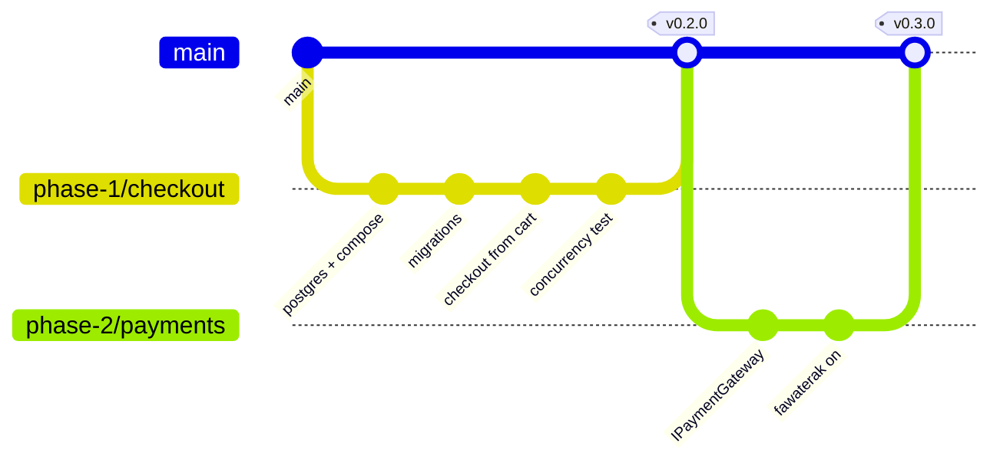
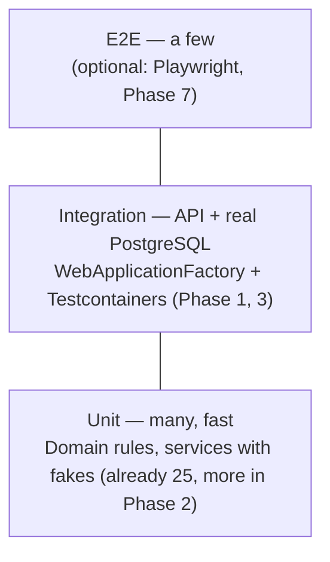

# Roadmap

The plan from where the project is today (updated 2026-10-18) to a deployed, full-stack store.
It replaces the long phase list in `build-plan.md` with a shorter one. The decisions recorded
there still apply.

**Target: about 6–7 weeks part-time** (Phase 3 is already done). Each phase ends with something that works and is merged to `main`.

| Phase | Goal | Size | Use cases | You learn |
|---|---|---|---|---|
| **0** | Save the work, put it on GitHub | ½ day | UC-04 | Git branches, PRs |
| **1** | Checkout from the cart + stock concurrency | 4–5 days | UC-06, UC-10 | Docker, optimistic concurrency, **Testcontainers** |
| **2** | Pluggable payments, Fawaterak back on | 3–4 days | UC-07, UC-14, UC-16, UC-17 | Strategy pattern, keyed DI, **mocking** |
| **3** | ✅ Login, roles, addresses, product admin API, PostgreSQL | done | UC-01 … UC-05, UC-11 (API) | Identity, JWT, refresh tokens, **API tests with auth** |
| **4** | Connect the React client | 1 week | UC-01 … UC-10 | TanStack Query, auth in a SPA |
| **5** | Admin dashboard | 1 week | UC-11 … UC-15 | Role-guarded routes, paging, filtering |
| **6** | Caching + messaging | 1 week | UC-01, UC-18 | Redis, HybridCache, RabbitMQ, outbox |
| **7** | Docker, CI, deploy, README | 1 week | — | Dockerfile, compose, GitHub Actions, HTTPS hosting |

**Scope rule:** if something isn't in this table, it waits until Phase 7 is live. That includes
coupons, reviews, wishlists, a separate tracking microservice, MediatR and API versioning.
A finished, deployed project beats a bigger unfinished one on a CV.

> **Why no MediatR?** It now needs a commercial licence for many uses, and `CartService` /
> `OrderService` are already one class per feature with clear use-case methods. You can still
> talk about CQRS: reads use `AsNoTracking` projections and writes go through the aggregates.

---

## Where we are now (2026-10-25)

**Phase 1 is done** (`v0.2.0`) and the **shop is redesigned** from the Stitch project (PR #6): light and dark theme,
22 products in five categories, filters and pagination, a cart page, checkout with saved addresses, order tracking
and cancel. **Phase 5 is half done**: the dashboard has its own layout with a side menu and four pages, the products
page is finished end to end, and the orders pages run on the admin orders API.
57 tests pass on PostgreSQL, in GitHub Actions on every push and pull request.

| Phase | Status |
|---|---|
| 0 Save + GitHub | ✅ done (PR #1), except the Projects board |
| 1 Checkout + concurrency | ✅ done: checkout from the cart, `xmin` + one retry, cancel, order tests, CI |
| 2 Pluggable payments | 🟡 Fawaterak is on (card only) and tested for real; **the pluggable design and fake-gateway tests left** |
| 3 Login, roles, addresses | ✅ done |
| 4 React client | ✅ every customer page, redesigned from Stitch with a dark theme; **guest cart and httpOnly cookie left** |
| 5 Admin dashboard | 🟡 products and orders done end to end; **the stats API is next** (branch `phase-5/admin-api`) |
| 6 Caching + messaging | ⬜ not started |
| 7 Docker, CI, deploy | ⬜ not started (AWS was considered; the VPS + Neon plan still stands) |

### Next up, in this order

Phase 5 is worked on the branch `phase-5/admin-api`, one commit per endpoint that works end to end (API, test and
the dashboard connected). How to build each step, with hints and code sketches, is in Phase 5 below.

**Done**

- ✅ Step 0, the shared stock retry
- ✅ Step 1, admin products: list with filters (search, category, availability, low stock, sort), add, **edit**,
  restock, price, show and hide, every action from the dashboard, and the shop updates without a refresh
- ✅ Client cleanup, the account dropdown, and the dashboard frame (sticky side menu that folds into icons)
- ✅ Step 2, admin orders: the list with status, date and search filters and a count per status, one order, and the
  status controls, connected to the orders pages and the recent orders on the overview (2026-10-27)

**You build next** (the client is ready and waits for these)

1. **Payment panel** on the order page: the event log and *Sync with gateway*, on the two endpoints that exist.
2. **Step 3, admin stats API**: revenue, active orders and orders per day for the overview cards and chart.
3. **Income page** (part F): `GET /admin/stats/income` and the Chart.js charts.
4. **React Query** across the client, now that every list has an API.
5. Then Phase 4 leftovers (guest cart, httpOnly cookie), Phase 2 (pluggable payments, kept as a later refactor),
   and Phases 6 → 7.

**Still missing in Phase 5** (each one is a box further down)

- Orders: the payment panel on the order page (event log and *Sync with gateway*), and the check by hand in the browser
- Overview: revenue, active orders and the chart are still sample numbers
- Income: the API and the charts
- Products, optional: uploading a photo instead of typing a URL

Dropped: `POST /orders/preview`. `GET /cart` already returns the totals the order will use.

---

## Git & GitHub workflow (every phase)

Set up once in Phase 0, then repeat for every task.



**The loop for each phase**

1. Open a GitHub **issue** per task (use the use-case id in the title: `UC-06 Checkout from cart`).
   Put them on a GitHub **Projects** board with the columns *Todo → In progress → Done*.
2. `git switch -c phase-1/checkout` from an up-to-date `main`.
3. Small commits, one idea each, with [Conventional Commits](https://www.conventionalcommits.org) messages:
   `feat(orders): place order from cart`, `fix(cart): …`, `test(orders): …`, `docs: …`, `chore: …`.
4. `git push -u origin phase-1/checkout`, then open a **pull request**. Write *Closes #12* in the
   description so the issue closes on merge.
5. Review your own PR on GitHub, reading the diff as if someone else wrote it. CI must be green (from Phase 1 on).
6. **Squash and merge**, delete the branch, and tag the release: `git tag v0.2.0 && git push --tags`.

**Rules**
- `main` is always working. You never commit to it directly; turn on branch protection in Phase 1.
- Never commit secrets. Fawaterak keys stay in `dotnet user-secrets` locally and in environment variables in production.
- Push at least once a day, even half-finished work on the branch. GitHub is your backup.

---

## Testing track (learn as you go)

You don't need a testing background. Each phase adds **one** new kind of test, and by Phase 7
you'll have all the layers of the "testing pyramid":



| Phase | New skill | First test to write |
|---|---|---|
| Now | **Read** the existing tests; learn the *Arrange / Act / Assert* shape | Read `CartServiceTests.cs`, then add `Cannot_add_more_than_100_of_one_product` |
| 1 | **Integration tests** with a real PostgreSQL in Docker (Testcontainers) | `Two_checkouts_for_the_last_unit_exactly_one_wins`, the most valuable test in the project |
| 2 | **Fakes / mocks**: replace the real gateway with a fake | `Gateway_timeout_cancels_order_and_releases_stock` |
| 3 ✅ | **API tests** through HTTP with a logged-in user | Done: read `tests/Audiophile.Tests/Api/AuthApiTests.cs` to see how they work |
| 6 | Testing **async messages** | `Placing_an_order_publishes_OrderPlaced` |
| 7 | **CI**: tests run on every PR; **coverage** report | — |

**Study list (short, in order):** Microsoft Learn *"Unit testing C# with xUnit"* → *"Integration
tests in ASP.NET Core"* → the Testcontainers for .NET *Getting started* page. Learn each one just
before the phase that needs it, not all up front.

---

## Phase 0 — Save the work, put it on GitHub · ✅ done 2026-10-17 (PR #1, `017aefc`)

- [x] Rename the local branch to match GitHub's default: `git branch -m master main`
- [x] `git switch -c phase-0/baseline`, then commit in three steps, so each commit tells one story:
  1. the backend: `feat: port auth, addresses and product admin from the original API; move to PostgreSQL`
     (cart, PostgreSQL + migration, Identity/JWT, the split EF configurations, the tests, the gateway switched off)
  2. `client/`: `feat(client): add React storefront`
  3. the docs: `docs: overview, use cases, diagrams, database, roadmap`
- [x] Create the GitHub repo and push: `gh repo create audiophile-store --private --source . --push`
  (`nourokbi/audiophile` is already taken by the original; archive that one on GitHub once this one is public)
- [x] Open a PR `phase-0/baseline → main`, review it, merge it
- [x] Delete the old merged branch: `git branch -d feature/paymob-integration`
- [x] First real start on PostgreSQL (the local PostgreSQL 18 service; Docker Desktop still to fix, needed in Phase 7)
- [ ] Create the Projects board and issues for Phase 1 (optional; one PR per step works too)

**Done when** GitHub shows `main` with everything on it, the API runs against PostgreSQL, and there's a Phase 1 board.

## Phase 1 — Checkout from the cart + stock concurrency · ✅ done 2026-10-18 (`v0.2.0`)

Already done: PostgreSQL via `docker-compose.yml`, the `InitialCreate` migration, `jsonb` for `InTheBox`,
`GET /products/{id}` and the paged, filtered `GET /products` (see Phase 3).

- [x] Add a **concurrency token** on `Product`: PostgreSQL's `xmin` column, via `b.Property<uint>("Version").IsRowVersion()`
      (migration `AddProductConcurrencyToken`, 2026-10-18)
- [x] On `DbUpdateConcurrencyException`, retry once, then return 409 (`OrderService.RetryOnStockConflictAsync`)
- [x] **Checkout from the cart** (UC-06, 2026-10-18): `POST /orders` takes `{ addressId, paymentMethod }`, not items and not a typed
      address. It reads the cart and the saved address, re-reads prices, decreases stock, places the order and clears
      the cart, all in one `SaveChanges`
- ~~`POST /orders/preview`~~ dropped: `GET /cart` already returns the same totals
- [x] `POST /orders/{id}/cancel` (UC-10): only while `CanBeCancelled`, it restores stock, and a paid card order is a 409 "contact support"
- [x] Tests on **PostgreSQL** instead of SQLite: `TestDatabase` makes a fresh, migrated database per test on the
      local server (done 2026-10-18; Testcontainers can replace it later, once Docker works)
- [x] Tests: the **concurrency test** (`StockConcurrencyTests` and `OrderApiTests`), a checkout happy path,
      idempotency, cancel, and "cannot read another customer's order"
- [x] **GitHub Actions** (`.github/workflows/ci.yml`): API tests against a PostgreSQL service container, plus the shop build
- [ ] Branch protection on `main` (needs a public repo or GitHub Pro for a private one)

**Done when** two parallel checkouts for the last unit produce one order and one 409, proven by a test running in CI.

## Phase 2 — Pluggable payments, Fawaterak back on · 3–4 days

The design is in [diagrams § 7](diagrams.md#7-pluggable-payment-gateways-strategy-pattern). You
already wrote most of it before; see `git show 8d972e7:src/Audiophile.Application/Payments/IPaymentGateway.cs`.

- [ ] `IPaymentGateway` (Name, `Supports(method)`, CreateCheckout, GetTransaction, ParseWebhook) in Application
- [ ] `FawaterakGateway : IPaymentGateway`, registered as a **keyed service** `"fawaterak"`
- [ ] `IPaymentGatewayResolver` picks the gateway for a payment method from config (`Payments:Methods:Card = fawaterak`)
- [ ] One webhook route for all providers: `POST /payments/{provider}/webhook`
- [x] Every `// PAYMENT GATEWAY (off)` block is live again (2026-10-18). Still to add: a `Payments:Enabled`
      setting, so turning payments off is configuration, not commented-out code
- [x] `PaymentExpiryWorker` and the sync endpoint are back (sync and events are admin-only)
- [x] Simplified to **card only** (wallet and kiosk removed, 2026-10-18); add them back as extra strategies
- [ ] Tests with a `FakePaymentGateway`: success, decline, timeout, webhook twice, wrong amount
- [x] One real payment end to end through ngrok with the staging test card (2026-10-18)

**Done when** card checkout works again and adding a second gateway would be one new class plus one config line.

## Phase 3 — Login, roles, addresses · ✅ done 2026-10-15

Ported from the original single-project API (`nourokbi/audiophile`) and rebuilt for the four layers and Identity.

- [x] `POST /auth/register` (201), `/auth/login`, `/auth/refresh` (rotates the token), `/auth/logout`, `GET /auth/me`
- [x] JWT with a `role` claim; `[Authorize]` on cart, orders and addresses; `[Authorize(Roles = Roles.Admin)]` on product writes
- [x] `ICurrentUser` replaces the demo user everywhere
- [x] Admin account created at startup from `Admin:Email` / `Admin:Password`; roles seeded by the migration
- [x] Addresses CRUD (UC-05), soft delete, 404 for someone else's address
- [x] Refresh tokens stored as SHA-256 hashes; reuse of a rotated token revokes every session of that user
- [x] Lockout after 5 wrong passwords; rate limits on login/refresh (10/min) and register (5/hour)
- [x] Products: paged, filtered list; get by id; admin create / update / deactivate (UC-01, UC-02, UC-11 API)
- [x] PostgreSQL + `InitialCreate` migration, check constraints, `docker-compose.yml`, Neon-ready configuration ([`database.md`](database.md))
- [x] 8 HTTP integration tests: register, duplicate email, login messages, 401 on cart, refresh reuse, logout, admin-only, address ownership

Moved on: "checkout takes an `addressId`" is part of Phase 1. Refresh-token *families* (revoking only the stolen
chain, not every session) are a possible refinement; revoking everything is the safer default.

## Phase 4 — Connect the React client · 1 week

- [x] `client/src/lib/api.js`: one `fetch` wrapper that adds the JWT, refreshes it once on 401, and reads the
      base URL from `VITE_API_URL` (done 2026-10-18)
- [ ] **TanStack Query** for server data (products, cart, orders); today it's React context + `fetch`. Moved to Phase 5, after the admin API
      `data.json` still supplies images and copy; prices, stock and ids come from the API (matched on slug)
- [x] Login / register pages (2026-10-18)
- [ ] Move the refresh token to an httpOnly cookie; today both tokens are in `localStorage`
- [x] Cart drawer uses the cart API (2026-10-18)
- [x] Checkout page: address → payment method → `POST /orders` with an `Idempotency-Key` →
      redirect to `checkoutUrl` (or straight to the order page for COD) (2026-10-18)
- [x] My orders page and an order progress page that polls until the webhook confirms (2026-10-18)
- [x] Home page lists every product as a card with quantity + *Add to cart*, filtered by category (2026-10-18)
- [ ] **Guest cart**: today you must log in before adding; keep a local cart and merge it into the server cart on login
- [x] *Cancel order* button on the order page (2026-10-18)
- [x] Fix the old lint errors (gone with the redesign; `npm run lint` passes with zero warnings)
- [x] **Redesign from the Stitch project** (2026-10-19): light theme, Lucide icons, one product list in `CatalogContext`,
      category pages folded into the storefront, search and *in stock only* filters, order tracker. See `docs/frontend.md`
- [x] CORS policy in the API for the client origin (`Cors:AllowedOrigins`)
- [x] Delete the old `wwwroot` demo storefront (removed 2026-10-15; it had no login)

## Phase 5 — Admin dashboard · 1 week

Same React app, under `/admin`, behind a route guard that checks the `Admin` role.

- [x] The page itself (2026-10-19), since split into `/admin` (overview), `/admin/products`, `/admin/orders`,
      `/admin/orders/:id` and `/admin/income` inside `AdminLayout` (2026-10-25)

### How to work through this phase

1. Stay on the branch `phase-5/admin-api`. Commit after every endpoint that works, open the pull request at the end.
2. Inside each step, build **one endpoint end to end** before starting the next, always in this order:
   **entity → contracts → service → controller → test → client**. Start with the hardest one of the step.
3. Try every endpoint by hand in `src/Audiophile.API/Audiophile.API.http` (log in as `admin@admin.com`, copy the
   token), then write its test.
4. After each step: `dotnet test` is green, then ask for a review (*"review my changes"*), then tick the boxes here.

### Rules for every admin endpoint

- **Logic lives in the entity's own service, not in an `AdminService`**: product actions go in `ProductService`,
  order actions in `OrderService`. Who calls a method (shop or admin) does not decide where it lives; only a job
  with no home of its own, like the dashboard stats, gets a new service.
- **One controller per area** in `src/Audiophile.API/Controllers/`: `AdminProductsController` (`[Route("admin/products")]`),
  `AdminOrdersController`, `AdminStatsController`, each with `[Authorize(Roles = Roles.Admin)]` on the class. Keep
  the `_productsService` naming. Each action is one line that calls one service method.
- **Rules stay in the entities** (`Product.Restock`, `Order.ChangeStatus`); the services only load, call and save.
- **Errors are already mapped** in `GlobalExceptionHandler`, so just throw:
  `NotFoundException` → 404, `ArgumentException` (what `Guard` throws) → 400,
  `ConflictException` and `InvalidOperationException` (what `ChangeStatus` throws) → 409.
- **Reads** are `AsNoTracking` projections straight into DTOs (`.Select(p => new ProductDto(...))`), and every
  list is paged with the `PagedResult<T>` from `Products/ProductContracts.cs`.
- **Stock changes** (restock, admin cancel) go through the `xmin` retry, because a restock and a checkout can touch
  the same product at once.
- **Tests**: every endpoint gets an HTTP test as the admin and one that a customer gets **403**.
- **Client**: every dashboard call lives in `client/src/lib/api/admin.js`, built on `api(path, { method, body })`
  from `lib/api/client.js`. Shop calls live next to it in `lib/api/` (`auth`, `cart`, `products`, `orders`, `addresses`).
- **Order rules on the client** live in `client/src/lib/orders.js` (`canCancel`, `isActiveOrder`, `PAYMENT_LABELS`), so the
  shop and the dashboard never write the same status list twice.

### Step 0 — Move the stock retry where both services can use it

`RetryOnStockConflictAsync` is private inside `OrderService` (`Orders/OrderService.cs`), and restock needs it too.

- [x] Move it to `src/Audiophile.Application/Common/StockConflictRetry.cs` as an extension on `IAppDbContext`
- [x] `OrderService` calls the shared one, and its tests still pass

```csharp
// Runs the work once more on fresh data when another request changed the same stock, a second conflict becomes a 409
public static class StockConflictRetry
{
  public static async Task<T> RetryOnStockConflictAsync<T>(this IAppDbContext db, Func<Task<T>> work)
  {
    try { return await work(); }
    catch (DbUpdateConcurrencyException)
    {
      db.ChangeTracker.Clear();      // forget the stale product so the second try reads the new stock
      return await work();
    }
  }
}
// Usage: return db.RetryOnStockConflictAsync(async () => { ...load, change, save... });
```

`IAppDbContext` already exposes `ChangeTracker`. The log line can move with it (pass an `ILogger`) or stay in the caller.

### Step 1 — Admin products API (UC-11) · ✅ done 2026-10-25

| Endpoint | Body | Answer | Used by |
|---|---|---|---|
| `GET /admin/products?page=&pageSize=` | | Page of products **including hidden ones** | Product table |
| `GET /admin/products/search?q=&page=` | | Search, also with hidden ones | Table search box |
| `POST /admin/products/{id}/restock` | `{ quantity }` | The product | *Restock* button |
| `PUT /admin/products/{id}/price` | `{ price }` | The product | *Price* button |
| `PUT /admin/products/{id}/availability` | `{ isActive }` | The product | *Available* switch |

Moved to `AdminProductsController` (done 2026-10-25): `POST /admin/products` (create), `PUT /admin/products/{id}`
(edit every field), `DELETE /admin/products/{id}` (hide), so every admin URL starts with `/admin` and
`ProductsController` only browses. The dashboard's disabled *Add product* button uses `POST /admin/products` in this step.

**Build it in this order**

- [x] **Entity**: add `public void Activate() => IsActive = true;` to `Product.cs`, next to `Deactivate()`
- [x] **List and search** (done 2026-10-22, moved 2026-10-25): search has its own `GET /products/search?q=`, the shop's
      list and search show only products on sale, and `GET /admin/products` and `/admin/products/search` call the same
      `ProductService` methods with hidden products included. `ProductDto` has `isActive` and `createdAt`, so every
      admin answer uses the same `ProductDto`
- [x] **Contracts** in `Products/ProductContracts.cs`, only the three request bodies:

  ```csharp
  public sealed record RestockRequest(int Quantity);
  public sealed record ChangePriceRequest(decimal Price);
  public sealed record SetAvailabilityRequest(bool IsActive);
  ```

- [x] **Service**: the three methods live in `ProductService` (no separate admin service)
  - [x] `SetAvailabilityAsync` returns the product, and `DELETE /admin/products/{id}` calls it with `false`
  - [x] `FindAnyAsync(id)` looks a product up **without** the `IsActive` check, so the admin reaches hidden ones
  - [x] `RestockAsync` (needs the retry), then `ChangePriceAsync`

  ```csharp
  public Task<ProductDto> RestockAsync(Guid id, int quantity, CancellationToken ct) =>
      db.RetryOnStockConflictAsync(logger, async () =>
      {
        var product = await FindAnyAsync(id, ct);
        product.Restock(quantity);            // Guard throws for quantity below 1, which becomes a 400
        await db.SaveChangesAsync(ct);
        return ProductDto.From(product);
      });
  ```

- [x] **Controller** `AdminProductsController.cs` holds every `/admin/products` route and calls `ProductService`:

  ```csharp
  [ApiController]
  [Route("admin/products")]
  [Authorize(Roles = Roles.Admin)]
  public sealed class AdminProductsController(ProductService _productsService) : ControllerBase
  {
    [HttpPost("{id:guid}/restock")]
    public async Task<IActionResult> Restock(Guid id, RestockRequest request, CancellationToken ct) =>
        Ok(await _productsService.RestockAsync(id, request.Quantity, ct));
  }
  ```

- [x] **Tests** in `tests/Audiophile.Tests/Api/AdminProductApiTests.cs` (copy the login and `CreateProductAsync`
      helpers from `OrderApiTests`, the admin logs in with `ApiFactory.AdminEmail` / `AdminPassword`):
  - restock 5 on a product with 3 gives 8
  - a product hidden with `availability false` is gone from `GET /products`, still in
    `GET /admin/products`, and comes back when set to `true`
  - quantity 0 and price 0 give 400, an unknown id gives 404
  - a customer gets 403 on all three endpoints
- [x] **Client**, in this order, run the API and `npm run dev` and check the page after each box:
  - [x] **1. Calls** `client/src/lib/adminApi.js`: give every function a real body with `api(path, { method, body })`
        and add `listProducts(page)`, `searchProducts(q, page)` and `createProduct(body)`
    `` restock: (id, quantity) => api(`/admin/products/${id}/restock`, { method: 'POST', body: { quantity } }) ``
  - [x] **2. One product shape**: `export` `toProduct` from `CatalogContext.jsx`, add `isActive: p.isActive` to it, and use
        `p.isActive` in `AdminProducts.jsx` where it says `p.available`
  - [x] **3. The table loads its own data** `AdminDashboard.jsx`: a `products` state filled from
        `adminApi.listProducts(page)` (`GET /admin/products`, already mapped with `toProduct`), so hidden products show up; `useCatalog`, the `changes`
        state and the `catalog.map(...)` line go away
  - [x] **4. Trust the server's answer** `AdminProducts.jsx`: `run(product, call)` keeps only `call`, and the product the API
        sends back replaces that row, `onChange(toProduct(await call()))`; the `patch` arguments go away
  - [x] **5. Paging and search**: *Previous* and *Next* under the table from `page` and `totalPages`, and a search box that
        calls `searchProducts` about 300 ms after the last key
  - [x] **6. Add product**: enable the button, a `Dialog` with the `ProductRequest` fields that calls `createProduct`, and the
        400 message shown inside the dialog
  - [x] **7. Switch off the placeholders**: delete `ADMIN_API_CONNECTED` and its sentence in the banner
  - [x] **8. Check by hand** (passed 2026-10-25): restock, change a price, hide a product (gone from the shop, faded in the table), show it again,
        add a product, and refresh the page to see every change was saved. After the client cleanup also click through
        the shop once: home filters and pages, a product, the cart, checkout with a new address, my orders, settings
  - [x] **9. Edit product**: an *Edit* button on every row opens the same dialog filled in, and saves with
        `PUT /admin/products/{id}`

- [x] **Decided** (2026-10-25): `PUT /admin/products/{id}` uses `FindAnyAsync`, so the admin can edit a hidden product
      and show it when it is ready. Only `GET /products/{id}` keeps `FindActiveAsync`.
- [x] **Fixed** (2026-10-25): the edit took the stock from the request, so a form opened before a checkout would put
      the old number back. The edit now has its own `UpdateProductRequest` without stock (stock only moves through
      restock and orders), and `inTheBox` left out keeps the box as it is. A test covers both
- [x] *In the box* in the add and edit dialog (2026-10-25): one row per item with its quantity and name, *Add an item*
      and a remove button per row, filled in on edit; empty rows are skipped, a missing name, a quantity under 1 or the
      same item twice is refused before saving
- [ ] Optional: a photo upload instead of the URL field

### Client cleanup (done 2026-10-25)

- [x] Folders: `components/layout`, `components/ui`, `components/shop`, `components/checkout`, `components/orders`,
      `components/admin`; every API call in `lib/api/`; `toProduct`, `productPath` and `stockLabel` in `lib/products.js`
- [x] Shared pieces: `PriceSummary`, `Switch`, `Select`, `TextArea`, `EmptyState`, `AddressLines`, and the
      `.field-label` and `.error-text` classes in `index.css`
- [x] Big pages split: `Home` into `Hero`, `ShopFilters`, `PromiseStrip` and the `useShopFilters` hook; `Checkout` into
      `AddressPicker`, `AddressForm` and `PaymentPicker`; `useAddresses` for checkout and settings
- [x] `useAuth()` returns `isAdmin`, and `<RequireAuth adminOnly />` guards `/admin`
- [x] Fixes: the shop loads every page of products (it stopped at 50), a catalogue error clears after a load that
      works, free shipping reads `SHIPPING.freeFrom`, pagination shows `1 ... 4 5 6 ... 20`, the dashboard code loads
      only on `/admin`
- [x] `client/.prettierrc` (tabs, single quotes, width 130, `endOfLine: auto` so each file keeps its line endings)

### Dashboard redesign (planned 2026-10-25)

What changes, in the order to build it. Each part says which API it needs.

| # | Part | Backend | Client |
|---|---|---|---|
| A | Account dropdown | none | `AccountMenu` replaces `UserDrawer` in the navbar |
| B | Dashboard frame | none | `AdminLayout` with a side menu, nested routes under `/admin` |
| C | Products page | filters on `GET /admin/products` | `/admin/products` with filters and paging |
| D | Orders page | Step 2 below, plus counts per status | `/admin/orders`, `/admin/orders/:id`, status controls |
| E | Overview | Step 3 below, whole business numbers | `/admin` cards and previews |
| F | Income page | `GET /admin/stats/income` | `/admin/income` with Chart.js |

**A. Account dropdown** (done 2026-10-25)
- [x] `components/layout/AccountMenu.jsx`: a small menu under the user icon (My orders, Settings, Admin dashboard for
      admins, the theme switch, Log out; Log in and Create account for visitors). It closes on a click outside or on Escape
- [x] Delete `UserDrawer.jsx` once nothing imports it

**B. Dashboard frame** (done 2026-10-25)
- [x] `components/admin/AdminLayout.jsx`: the side menu that used to be the drawer (Overview, Products, Orders, Income),
      sticky on the left under the header, the page on the right with `<Outlet />`. *Collapse* folds it into a bar of
      icons and the choice is remembered in the browser; on a phone it always stays folded
- [x] Routes in `App.jsx` under `<RequireAuth adminOnly />`: `/admin` (overview), `/admin/products`, `/admin/orders`,
      `/admin/orders/:id`, `/admin/income`, each page loaded with `React.lazy`
- [x] `pages/admin/` holds one page per route; `AdminDashboard.jsx` became `pages/admin/Products.jsx` and
      `pages/admin/Overview.jsx` holds the cards and previews. Orders and Income show the sample data until their API exists
- [x] The overview's *Products on sale* and *Low stock* cards and the low stock preview already count the whole
      catalogue, from two small filtered pages of `GET /admin/products` (`useInventorySummary`), until Step 3

**C. Products page** (done 2026-10-25)
- [x] **Backend**: `GET /admin/products` takes `q`, `availability=All|OnSale|Hidden`, `lowStockOnly=true` and
      `sort=Name|Newest|PriceLowToHigh|PriceHighToLow|StockLowToHigh`, all in `ProductQuery` (admin only, the shop
      ignores them), `ProductQuery.LowStockLimit = 8` is the one low stock number, and two tests cover them
- [x] **Client**: a filter bar above `ProductsTable` (category, availability, low stock only, sort, search), every filter
      in the URL (`useSearchParams`) so a refresh keeps it, and the *Add product* button moves here

**D. Orders page**: Step 2 below, plus
- [x] **Backend**: the order list answer also carries `statusCounts` (`{ Pending: 3, Confirmed: 5, ... }`) for the
      filtered dates, so the page shows the numbers without a second call
- [x] **Order phases have their own logic**: the API decides the allowed moves (`Order.NextStatuses`) and every admin
      order answer carries `nextStatuses`. The client never guesses: `lib/orderHelpers.js` only labels them, and
      `components/admin/OrderStatusControl.jsx` draws one button per entry, with a confirm step for *Cancelled*
- [x] **Client layout** (2026-10-25, on sample data): `useAdminOrders` and `useAdminProducts` share `useUrlFilters`;
      `/admin/orders` has `OrderStatusTabs` with counts, `OrderFilters` (search, from and to dates), `OrdersTable` with a
      quick *next step* button per row and *Export CSV*; `/admin/orders/:id` has the progress, items, customer, address,
      `OrderStatusControl` and a `ConfirmDialog` before *Cancel*. The orders come from `data/adminOrdersSample.js`, a
      pretend server with the planned answers (`statusCounts`, `nextStatuses`, a 409 for an illegal move)
- [x] **Connect it** (2026-10-27): `listOrders`, `getOrder` and `changeOrderStatus` in `lib/api/admin.js`, the three
      hooks read `adminApi`, and `data/adminOrdersSample.js` is deleted
- [ ] The payment panel on the order page: the event log, *Sync with gateway*, and a *Refund needed* badge on a
      cancelled order whose payment is still `Succeeded`

**E. Overview**: Step 3 below, and
- [ ] The four cards count the **whole business**, never the page in view: products on sale, active orders, low stock
      products, revenue in the last 30 days. `AdminStatsDto` gets `ProductCount` and `LowStockCount`
- [ ] Previews under the cards, each with a *See all* link to its page: the last 5 orders, the 5 lowest stock
      products, orders this week
- [ ] `client/src/data/adminSample.js` is deleted

**F. Income page** (last)
- [ ] **Backend**: `GET /admin/stats/income?from=&to=` with revenue per day, per payment method and per category, using
      the same revenue rule as Step 3 (paid card orders plus delivered cash orders)
- [ ] **Client**: Chart.js (`react-chartjs-2`) line chart of revenue per day, bars per category, a date range picker,
      and totals for the period

### Step 2 — Admin orders API (UC-12, UC-13, UC-14) · ✅ done 2026-10-27, except the payment panel

| Endpoint | Body | Answer | Used by |
|---|---|---|---|
| `GET /admin/orders?status=&from=&to=&q=&page=&pageSize=` | | Page of orders, newest first, with the customer's name and email, plus `statusCounts` | Orders page, recent orders on the overview, *Export CSV* |
| `GET /admin/orders/{id}` | | The order with its customer, shipping address, items and payment | Order details page |
| `PUT /admin/orders/{id}/status` | `{ status }` | The order | *Next status* buttons |

Already there and reused: `GET /orders/{id}/payment/events` and `POST /orders/{id}/payment/sync` for the payment panel.

**The answers** the client reads:

- **Summary** in the list: `id, createdAt, updatedAt, customerName, customerEmail, status, paymentMethod,
  paymentStatus, subTotal, shippingFee, totalAmount, itemCount` (the sum of the quantities) and `nextStatuses`
- **One order**: the summary plus `shipping { fullName, phone, street, city, country, postalCode }` and
  `items [{ productId, productName, productImageUrl, unitPrice, quantity, lineTotal }]`
- **The list page**: `{ items, page, pageSize, totalCount, totalPages, statusCounts }`. `statusCounts` counts every
  status for the search and dates but **ignores the status filter**, so every tab keeps its number
- `q` searches the customer's name and email, and an order number typed from its start (the first 8 characters shown)
- `from` and `to` are days like `2026-10-25`, and `to` includes the whole day

**Build it in this order**

- [x] **Entity**: `Order.NextStatuses`, and `Order.NextStatusesFor(status)` that the list query calls with only the
      status column
- [x] **Contracts** in `Orders/OrderContracts.cs`: `AdminOrderQuery(Status, From, To, Search, Page, PageSize)`,
      `AdminOrderSummaryDto` and `AdminOrderDto` with the fields above, `AdminOrderPage` (the paged list plus
      `StatusCounts`), and `ChangeStatusRequest(OrderStatus Status)`
- [x] **Service**: the admin order methods go in `OrderService`:
  - `ListAllOrdersAsync`: `db.Orders.AsNoTracking()`, filter by status, `CreatedAt >= from` and `< to.AddDays(1)`, search on
    `o.User.Name` / `o.User.Email`, `OrderByDescending(o => o.CreatedAt)`, page, then `Select` into the summary.
    Sum the quantities with `o.OrderItems.Sum(i => i.Quantity)` inside the projection so it stays one SQL query.
    `StatusCounts`: the same query without the status filter, `GroupBy(o => o.Status).Select(g => new { g.Key, Count = g.Count() })`
  - `GetAnyOrderAsync`: include `User`, `Payment`, `OrderItems.Product`, 404 when missing
  - `ChangeOrderStatusAsync` **first** in this step:

    ```csharp
    public Task<AdminOrderDto> ChangeOrderStatusAsync(Guid id, OrderStatus next, CancellationToken ct) =>
        db.RetryOnStockConflictAsync(logger, async () =>
        {
          var order = await OrderWithDetailsAsync(id, ct);
          if (next == OrderStatus.Cancelled)
            order.Cancel();                  // puts the stock back and fails a pending payment
          else
            order.ChangeStatus(next);         // an illegal move throws InvalidOperationException, which becomes a 409
          await db.SaveChangesAsync(ct);
          return AdminOrderDto.From(order);
        });
    ```

  - **Decided** (2026-10-27): a cash order is already Confirmed when it is placed, so only card orders are ever Pending.
    `Order` itself keeps `Confirmed` out of a card order's `nextStatuses` until its payment succeeded, so the page shows
    no *Confirm* button and the API answers 409; the webhook or *Sync with gateway* confirms it.
    The admin **can** cancel a paid card order, the page warns first and the refund is made by hand on Fawaterak
- [x] **Controller** `AdminOrdersController` with `[Route("admin/orders")]`
- [x] **Tests** `AdminOrderApiTests.cs` (7): Confirmed → Processing → Shipped → Delivered works, a status that is not
      next is 409, an unpaid card order cannot be confirmed but can be cancelled (with a fake gateway), admin cancel
      puts the stock back, one order has its address and items, the list filters by status, search and dates and
      counts every status, a customer gets 403
- [x] **Client pages**: built on sample data, see part D of *Dashboard redesign* above
- [x] **Client, connect it**: see part D
- [ ] The payment panel (part D), and the check by hand: filter, open an order, walk it to Delivered, cancel one

### Step 3 — Admin stats API (UC-15)

| Endpoint | Answer | Used by |
|---|---|---|
| `GET /admin/stats?days=30` | Revenue and order count for the period, active orders, orders per day for the last 7 days, low stock products | Stat cards, *Orders this week*, *Low stock* |

**Build it in this order**

- [ ] **Contracts**: `AdminStatsDto(decimal Revenue, int OrderCount, int ActiveOrders, int ProductCount, int LowStockCount,
      IReadOnlyList<DailyOrders> OrdersPerDay, IReadOnlyList<ProductDto> LowStock)` and
      `DailyOrders(DateOnly Day, int Count, decimal Revenue)`
- [ ] **Service** `AdminStatsService.GetAsync(days)`, every query `AsNoTracking`:
  - **Revenue**: orders in the period whose `Payment.Status == Succeeded`, **plus** cash orders that are `Delivered`;
    cancelled orders never count. `SumAsync(o => o.TotalAmount)`
  - **Active orders**: status is Pending, Confirmed, Processing or Shipped
  - **Orders per day**: `GroupBy(o => o.CreatedAt.Date)` for the last 7 days, then fill the days with no orders with
    0 in C#, so the chart always has 7 bars
  - **Low stock**: active products with `Stock <= 8` (the same `LOW_STOCK` the page uses; make it one constant)
  - Check `days` is between 1 and 365, otherwise `ArgumentException`
- [ ] **Controller** `AdminStatsController` with `[Route("admin/stats")]`
- [ ] **Tests**: seed a paid card order, a delivered cash order, a pending cash order and a cancelled one, and check
      that the revenue is only the first two; a customer gets 403
- [ ] **Client**: `useAdminStats` feeds `StatCards` (revenue, active orders) and `OrdersChart` on `pages/admin/Overview.jsx`;
      the product cards and the low stock list already read live data through `useInventorySummary`, which the stats
      can replace; delete `client/src/data/adminSample.js` once nothing imports it, and the sample data notes

### Optional — Users

`GET /admin/users` and `PUT /admin/users/{id}/role` for the Stitch *Users & Roles* screen, if there is time.
Use `UserManager` (`AddToRoleAsync` / `RemoveFromRoleAsync`), and refuse to remove the Admin role from yourself.

### Do not forget, after the admin API exists

- [ ] **TanStack Query (React Query)** for every server call: products, cart, orders and the admin lists. It brings
      caching, loading and error state, refetch after a change (restock, cancel) and polling (it replaces the
      3 second timer in `OrderDetail.jsx`). Keep `lib/api/client.js` as the function each query calls; no need for axios.
- [ ] **Chart.js** (with `react-chartjs-2`) for the dashboard: replace the `div` bars in `components/admin/OrdersChart.jsx`
      with a bar chart fed by `GET /admin/stats`, then the income page charts (part F).

**Done when** every number and button on the dashboard comes from the API (no file left in `client/src/data/admin*`),
a customer gets 403 on every `/admin` endpoint, and a check by hand of every admin page passes. Tag `v0.3.0`.

## Phase 6 — Caching + messaging · 1 week

**Caching (2 days)**
- [ ] Redis in `docker-compose.yml`
- [ ] **HybridCache** (`Microsoft.Extensions.Caching.Hybrid`) with Redis as the shared layer, for product list and details: *cache-aside*
- [ ] Remove cache entries when an admin edits a product (invalidate on write)
- [ ] Measure before and after with a simple load test (`k6` or `bombardier`); put the numbers in the README

**Messaging (3 days)**
- [ ] RabbitMQ in compose; **MassTransit v8** (open source; v9 is commercial)
- [ ] Events: `OrderPlaced`, `PaymentSucceeded`, `OrderStatusChanged`, `StockLow`
- [ ] **Transactional outbox** (MassTransit EF Core outbox), so events are saved in the same transaction as the order
- [ ] Consumer: send emails (use **Mailpit** in Docker locally, so no real emails are sent)
- [ ] Consumers must be idempotent (the same message twice = one email)

## Phase 7 — Docker, CI, deploy, README · 1 week

- [ ] Multi-stage `Dockerfile` for the API; `Dockerfile` for the client (build with Node, serve with nginx)
- [ ] `docker compose up` runs the whole system: client, api, postgres (already there), redis, rabbitmq, mailpit
- [ ] GitHub Actions: test → build images → push to GHCR on merge to `main`
- [ ] Deploy: the simplest path is **one small VPS + docker compose + Caddy** (automatic HTTPS, which the Fawaterak webhook needs)
- [ ] Database: **Neon** (free tier). CI runs the EF migration bundle against Neon's direct connection before
      deploying; the API uses the pooled one. Every step is in [`database.md`](database.md)
- [ ] Health checks (`/health` checks the DB, Redis and RabbitMQ); structured logs (Serilog)
- [ ] README: live link, screenshots, architecture diagram, *"hard problems and how I solved them"*, how to run
- [ ] Make the repo public, pin it on your GitHub profile, add it to your CV

**Load and security testing (before going public)**

Run these against the deployed server, or one like it, never the dev laptop, so the numbers mean something.

- [ ] **k6** scripts in `tests/load/`: `products.js` (browse the shop) and `checkout.js` (many users buy the same
      product at once, so the `xmin` retry and the database connections are under pressure)
- [ ] Find the capacity: raise the virtual users step by step (100, 200, 500) until p95 goes over 500 ms or errors
      go over 1%; the last step that passed is how many users the site handles. Put the numbers in the README
- [ ] Rate limiting with ASP.NET Core's `AddRateLimiter` on `/auth/login`, `/auth/register` and checkout, answering
      429 when one IP sends too many requests
- [ ] Lock an account for a few minutes after repeated failed logins (Identity `LockoutOptions`)
- [ ] **OWASP ZAP** baseline scan against the running API and client; fix what it reports (security headers, CORS,
      cookies)
- [ ] Dependency checks: `dotnet list package --vulnerable` and `npm audit` in CI; turn on **Dependabot** and
      **CodeQL** in the GitHub repo settings

---

## Future improvements (after Phase 7)

Ideas kept out of scope on purpose, each one is worth doing only once the store is live.

### Refunds through the Fawaterak API

Today a cancel never moves money. A paid card order cancelled by the admin keeps its payment `Succeeded`, and the refund
is made by hand in the Fawaterak dashboard. The API this project uses (API key, `FawaterakGateway`) has no refund call.

Found on 2026-10-27, **not confirmed yet**: Fawaterak's official documentation lists a *Refund APIs* section, and an
unofficial SDK for **API v3** (OAuth2 client credentials) creates, lists and cancels refund requests for an invoice or a
transaction; only a pending request can be cancelled, an approved refund is final, and Fawaterak calls a refund webhook
once it is approved.

- [ ] **Confirm first**: read the *Refund APIs* page logged in, and ask Fawaterak support whether this account can use
      API v3 and its refunds
- [ ] **Gateway**: `RefundAsync(payment, amount, reason)` on the payment gateway (it fits the `IPaymentGateway` of
      Phase 2), plus the v3 OAuth2 token
- [ ] **Domain**: `Refunded` payment status and `Payment.MarkRefunded()`; a refund request that is still pending shows
      as *Refund requested*
- [ ] **Flow**: the admin cancel of a paid card order asks for the refund, the signed refund webhook (or a lookup, like
      *Sync with gateway*) marks it `Refunded`, every step recorded as a `PaymentEvent`
- [ ] **Tests** with the fake gateway: refund asked once, webhook twice, refund refused
- [ ] **Until then**: a *Refund needed* badge on cancelled orders whose payment is still `Succeeded` (part of the
      payment panel in Phase 5)

---

## Interview story (fill in as you finish phases)

The things to be ready to explain, each in 2–3 sentences:

1. **Clean Architecture.** Why four projects, and what you'd change to swap the database or the gateway.
2. **Overselling.** How two people can't both buy the last item (optimistic concurrency + the test that proves it).
3. **Double payments.** The idempotency key on checkout, plus unique `PaymentEvent`s for webhooks.
4. **Trusting the gateway.** HMAC signature + re-checking the amount + never cancelling on an unknown outcome.
5. **Adding a gateway.** The Strategy pattern, and how many files a new gateway touches (answer: one, plus config).
6. **Reliability.** Retries only on safe calls, circuit breaker, expiry worker, outbox.
7. **Scaling.** Stateless API + Redis cache, so you can run 2+ API containers behind a load balancer.
