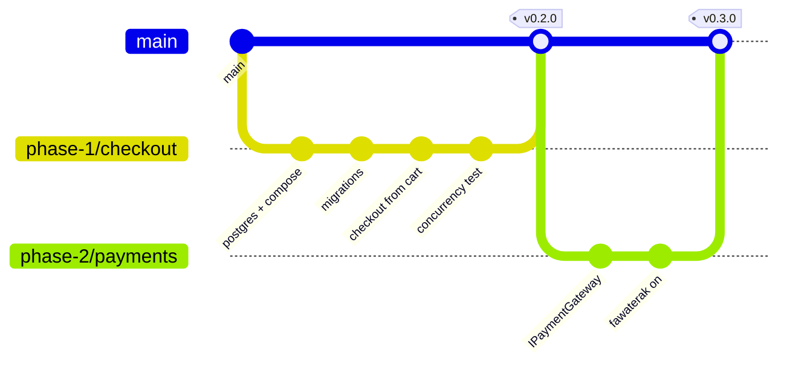
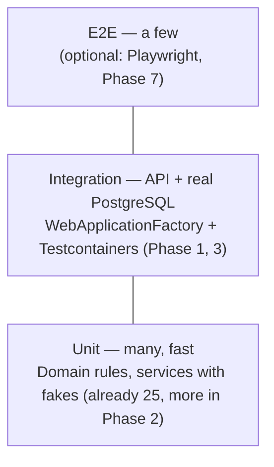

# Roadmap

The plan from where the project is today (updated 2026-10-18) to a deployed, full-stack store.
It replaces the long phase list in `build-plan.md` with a shorter one. The decisions recorded
there still apply.

**Target: about 6–7 weeks part-time** (Phase 3 is already done). Each phase ends with something that works and is merged to `main`.

| Phase | Goal | Size | Use cases | You learn |
|---|---|---|---|---|
| **0** | Save the work, put it on GitHub | ½ day | UC-04 | Git branches, PRs |
| **1** | Checkout from the cart + stock concurrency | 4–5 days | UC-06, UC-10 | Docker, optimistic concurrency, **Testcontainers** |
| **2** | Pluggable payments, Fawaterak back on | 3–4 days | UC-07, UC-14, UC-16, UC-17 | Strategy pattern, keyed DI, **mocking** |
| **3** | ✅ Login, roles, addresses, product admin API, PostgreSQL | done | UC-01 … UC-05, UC-11 (API) | Identity, JWT, refresh tokens, **API tests with auth** |
| **4** | Connect the React client | 1 week | UC-01 … UC-10 | TanStack Query, auth in a SPA |
| **5** | Admin dashboard | 1 week | UC-11 … UC-15 | Role-guarded routes, paging, filtering |
| **6** | Caching + messaging | 1 week | UC-01, UC-18 | Redis, HybridCache, RabbitMQ, outbox |
| **7** | Docker, CI, deploy, README | 1 week | — | Dockerfile, compose, GitHub Actions, HTTPS hosting |

**Scope rule:** if something isn't in this table, it waits until Phase 7 is live. That includes
coupons, reviews, wishlists, a separate tracking microservice, MediatR and API versioning.
A finished, deployed project beats a bigger unfinished one on a CV.

> **Why no MediatR?** It now needs a commercial licence for many uses, and `CartService` /
> `OrderService` are already one class per feature with clear use-case methods. You can still
> talk about CQRS: reads use `AsNoTracking` projections and writes go through the aggregates.

---

## Where we are now (2026-10-18)

**Phase 1 is done** (`v0.2.0`). A customer can sign up, fill a cart from the home page, check out, pay by card on
Fawaterak (staging), watch the order turn *Confirmed* when the webhook arrives, and cancel an unpaid order.
Two checkouts for the last unit give one order and one 409. 37 tests pass on PostgreSQL, in GitHub Actions on
every push and pull request.

| Phase | Status |
|---|---|
| 0 Save + GitHub | ✅ done (PR #1), except the Projects board |
| 1 Checkout + concurrency | ✅ done: checkout from the cart, `xmin` + one retry, cancel, order tests, CI |
| 2 Pluggable payments | 🟡 Fawaterak is on (card only) and tested for real; **the pluggable design and fake-gateway tests left** |
| 3 Login, roles, addresses | ✅ done |
| 4 React client | 🟡 redesigned from Stitch (light theme, Lucide icons) with every customer page; **guest cart, httpOnly cookie left** |
| 5 Admin dashboard | ⬜ not started |
| 6 Caching + messaging | ⬜ not started |
| 7 Docker, CI, deploy | ⬜ not started (AWS was considered; the VPS + Neon plan still stands) |

### Next up, in this order

One branch and one PR each.

1. **Phase 2**: `IPaymentGateway` + keyed services + resolver, one webhook route `POST /payments/{provider}/webhook`,
   `Payments:Enabled`, `FakePaymentGateway` tests. Optionally bring wallet or Fawry back as a second strategy.
2. **Phase 4 leftovers**: guest cart (merged on login), refresh token in an httpOnly cookie.
3. Then Phases 5 → 6 → 7.

Dropped: `POST /orders/preview`. `GET /cart` already returns the totals the order will use.

---

## Git & GitHub workflow (every phase)

Set up once in Phase 0, then repeat for every task.

**The loop for each phase**

1. Open a GitHub **issue** per task (use the use-case id in the title: `UC-06 Checkout from cart`).
   Put them on a GitHub **Projects** board with the columns *Todo → In progress → Done*.
2. `git switch -c phase-1/checkout` from an up-to-date `main`.
3. Small commits, one idea each, with [Conventional Commits](https://www.conventionalcommits.org) messages:
   `feat(orders): place order from cart`, `fix(cart): …`, `test(orders): …`, `docs: …`, `chore: …`.
4. `git push -u origin phase-1/checkout`, then open a **pull request**. Write *Closes #12* in the
   description so the issue closes on merge.
5. Review your own PR on GitHub, reading the diff as if someone else wrote it. CI must be green (from Phase 1 on).
6. **Squash and merge**, delete the branch, and tag the release: `git tag v0.2.0 && git push --tags`.

**Rules**
- `main` is always working. You never commit to it directly; turn on branch protection in Phase 1.
- Never commit secrets. Fawaterak keys stay in `dotnet user-secrets` locally and in environment variables in production.
- Push at least once a day, even half-finished work on the branch. GitHub is your backup.

---

## Testing track (learn as you go)

You don't need a testing background. Each phase adds **one** new kind of test, and by Phase 7
you'll have all the layers of the "testing pyramid":

| Phase | New skill | First test to write |
|---|---|---|
| Now | **Read** the existing tests; learn the *Arrange / Act / Assert* shape | Read `CartServiceTests.cs`, then add `Cannot_add_more_than_100_of_one_product` |
| 1 | **Integration tests** with a real PostgreSQL in Docker (Testcontainers) | `Two_checkouts_for_the_last_unit_exactly_one_wins`, the most valuable test in the project |
| 2 | **Fakes / mocks**: replace the real gateway with a fake | `Gateway_timeout_cancels_order_and_releases_stock` |
| 3 ✅ | **API tests** through HTTP with a logged-in user | Done: read `tests/Audiophile.Tests/Api/AuthApiTests.cs` to see how they work |
| 6 | Testing **async messages** | `Placing_an_order_publishes_OrderPlaced` |
| 7 | **CI**: tests run on every PR; **coverage** report | — |

**Study list (short, in order):** Microsoft Learn *"Unit testing C# with xUnit"* → *"Integration
tests in ASP.NET Core"* → the Testcontainers for .NET *Getting started* page. Learn each one just
before the phase that needs it, not all up front.

---

## Phase 0 — Save the work, put it on GitHub · ✅ done 2026-10-17 (PR #1, `017aefc`)

- [x] Rename the local branch to match GitHub's default: `git branch -m master main`
- [x] `git switch -c phase-0/baseline`, then commit in three steps, so each commit tells one story:
  1. the backend: `feat: port auth, addresses and product admin from the original API; move to PostgreSQL`
     (cart, PostgreSQL + migration, Identity/JWT, the split EF configurations, the tests, the gateway switched off)
  2. `client/`: `feat(client): add React storefront`
  3. the docs: `docs: overview, use cases, diagrams, database, roadmap`
- [x] Create the GitHub repo and push: `gh repo create audiophile-store --private --source . --push`
  (`nourokbi/audiophile` is already taken by the original; archive that one on GitHub once this one is public)
- [x] Open a PR `phase-0/baseline → main`, review it, merge it
- [x] Delete the old merged branch: `git branch -d feature/paymob-integration`
- [x] First real start on PostgreSQL (the local PostgreSQL 18 service; Docker Desktop still to fix, needed in Phase 7)
- [ ] Create the Projects board and issues for Phase 1 (optional; one PR per step works too)

**Done when** GitHub shows `main` with everything on it, the API runs against PostgreSQL, and there's a Phase 1 board.

## Phase 1 — Checkout from the cart + stock concurrency · ✅ done 2026-10-18 (`v0.2.0`)

Already done: PostgreSQL via `docker-compose.yml`, the `InitialCreate` migration, `jsonb` for `InTheBox`,
`GET /products/{id}` and the paged, filtered `GET /products` (see Phase 3).

- [x] Add a **concurrency token** on `Product`: PostgreSQL's `xmin` column, via `b.Property<uint>("Version").IsRowVersion()`
      (migration `AddProductConcurrencyToken`, 2026-10-18)
- [x] On `DbUpdateConcurrencyException`, retry once, then return 409 (`OrderService.RetryOnStockConflictAsync`)
- [x] **Checkout from the cart** (UC-06, 2026-10-18): `POST /orders` takes `{ addressId, paymentMethod }`, not items and not a typed
      address. It reads the cart and the saved address, re-reads prices, decreases stock, places the order and clears
      the cart, all in one `SaveChanges`
- ~~`POST /orders/preview`~~ dropped: `GET /cart` already returns the same totals
- [x] `POST /orders/{id}/cancel` (UC-10): only while `CanBeCancelled`, it restores stock, and a paid card order is a 409 "contact support"
- [x] Tests on **PostgreSQL** instead of SQLite: `TestDatabase` makes a fresh, migrated database per test on the
      local server (done 2026-10-18; Testcontainers can replace it later, once Docker works)
- [x] Tests: the **concurrency test** (`StockConcurrencyTests` and `OrderApiTests`), a checkout happy path,
      idempotency, cancel, and "cannot read another customer's order"
- [x] **GitHub Actions** (`.github/workflows/ci.yml`): API tests against a PostgreSQL service container, plus the shop build
- [ ] Branch protection on `main` (needs a public repo or GitHub Pro for a private one)

**Done when** two parallel checkouts for the last unit produce one order and one 409, proven by a test running in CI.

## Phase 2 — Pluggable payments, Fawaterak back on · 3–4 days

The design is in [diagrams § 7](diagrams.md#7-pluggable-payment-gateways-strategy-pattern). You
already wrote most of it before; see `git show 8d972e7:src/Audiophile.Application/Payments/IPaymentGateway.cs`.

- [ ] `IPaymentGateway` (Name, `Supports(method)`, CreateCheckout, GetTransaction, ParseWebhook) in Application
- [ ] `FawaterakGateway : IPaymentGateway`, registered as a **keyed service** `"fawaterak"`
- [ ] `IPaymentGatewayResolver` picks the gateway for a payment method from config (`Payments:Methods:Card = fawaterak`)
- [ ] One webhook route for all providers: `POST /payments/{provider}/webhook`
- [x] Every `// PAYMENT GATEWAY (off)` block is live again (2026-10-18). Still to add: a `Payments:Enabled`
      setting, so turning payments off is configuration, not commented-out code
- [x] `PaymentExpiryWorker` and the sync endpoint are back (sync and events are admin-only)
- [x] Simplified to **card only** (wallet and kiosk removed, 2026-10-18); add them back as extra strategies
- [ ] Tests with a `FakePaymentGateway`: success, decline, timeout, webhook twice, wrong amount
- [x] One real payment end to end through ngrok with the staging test card (2026-10-18)

**Done when** card checkout works again and adding a second gateway would be one new class plus one config line.

## Phase 3 — Login, roles, addresses · ✅ done 2026-10-15

Ported from the original single-project API (`nourokbi/audiophile`) and rebuilt for the four layers and Identity.

- [x] `POST /auth/register` (201), `/auth/login`, `/auth/refresh` (rotates the token), `/auth/logout`, `GET /auth/me`
- [x] JWT with a `role` claim; `[Authorize]` on cart, orders and addresses; `[Authorize(Roles = Roles.Admin)]` on product writes
- [x] `ICurrentUser` replaces the demo user everywhere
- [x] Admin account created at startup from `Admin:Email` / `Admin:Password`; roles seeded by the migration
- [x] Addresses CRUD (UC-05), soft delete, 404 for someone else's address
- [x] Refresh tokens stored as SHA-256 hashes; reuse of a rotated token revokes every session of that user
- [x] Lockout after 5 wrong passwords; rate limits on login/refresh (10/min) and register (5/hour)
- [x] Products: paged, filtered list; get by id; admin create / update / deactivate (UC-01, UC-02, UC-11 API)
- [x] PostgreSQL + `InitialCreate` migration, check constraints, `docker-compose.yml`, Neon-ready configuration ([`database.md`](database.md))
- [x] 8 HTTP integration tests: register, duplicate email, login messages, 401 on cart, refresh reuse, logout, admin-only, address ownership

Moved on: "checkout takes an `addressId`" is part of Phase 1. Refresh-token *families* (revoking only the stolen
chain, not every session) are a possible refinement; revoking everything is the safer default.

## Phase 4 — Connect the React client · 1 week

- [x] `client/src/lib/api.js`: one `fetch` wrapper that adds the JWT, refreshes it once on 401, and reads the
      base URL from `VITE_API_URL` (done 2026-10-18)
- [ ] **TanStack Query** for server data (products, cart, orders); today it's React context + `fetch`.
      `data.json` still supplies images and copy; prices, stock and ids come from the API (matched on slug)
- [x] Login / register pages (2026-10-18)
- [ ] Move the refresh token to an httpOnly cookie; today both tokens are in `localStorage`
- [x] Cart drawer uses the cart API (2026-10-18)
- [x] Checkout page: address → payment method → `POST /orders` with an `Idempotency-Key` →
      redirect to `checkoutUrl` (or straight to the order page for COD) (2026-10-18)
- [x] My orders page and an order progress page that polls until the webhook confirms (2026-10-18)
- [x] Home page lists every product as a card with quantity + *Add to cart*, filtered by category (2026-10-18)
- [ ] **Guest cart**: today you must log in before adding; keep a local cart and merge it into the server cart on login
- [x] *Cancel order* button on the order page (2026-10-18)
- [x] Fix the old lint errors (gone with the redesign; `npm run lint` passes with zero warnings)
- [x] **Redesign from the Stitch project** (2026-10-19): light theme, Lucide icons, one product list in `CatalogContext`,
      category pages folded into the storefront, search and *in stock only* filters, order tracker. See `docs/frontend.md`
- [x] CORS policy in the API for the client origin (`Cors:AllowedOrigins`)
- [x] Delete the old `wwwroot` demo storefront (removed 2026-10-15; it had no login)

## Phase 5 — Admin dashboard · 1 week

Same React app, under `/admin`, behind a route guard that checks the `Admin` role.

- [x] The page itself (2026-10-19): stat cards, orders chart, low stock, recent orders and the product table. Products
      are live; revenue, the chart and recent orders are sample data in `client/src/data/adminSample.js` until the
      endpoints below exist

- [ ] Products: table, create / edit / deactivate, set stock and price (UC-11)
- [ ] Orders: table with filter by status and date, paged (UC-12)
- [ ] Order details: items, customer, payment, the *next status* buttons the state machine allows (UC-13)
- [ ] Payment panel: the event log and a *Sync with gateway* button (UC-14)
- [ ] Overview cards: today's sales, orders by status, low-stock products (UC-15)
- [ ] API side: `/admin/products`, `/admin/orders`, `/admin/stats`, all paged, all `AsNoTracking` projections

## Phase 6 — Caching + messaging · 1 week

**Caching (2 days)**
- [ ] Redis in `docker-compose.yml`
- [ ] **HybridCache** (`Microsoft.Extensions.Caching.Hybrid`) with Redis as the shared layer, for product list and details: *cache-aside*
- [ ] Remove cache entries when an admin edits a product (invalidate on write)
- [ ] Measure before and after with a simple load test (`k6` or `bombardier`); put the numbers in the README

**Messaging (3 days)**
- [ ] RabbitMQ in compose; **MassTransit v8** (open source; v9 is commercial)
- [ ] Events: `OrderPlaced`, `PaymentSucceeded`, `OrderStatusChanged`, `StockLow`
- [ ] **Transactional outbox** (MassTransit EF Core outbox), so events are saved in the same transaction as the order
- [ ] Consumer: send emails (use **Mailpit** in Docker locally, so no real emails are sent)
- [ ] Consumers must be idempotent (the same message twice = one email)

## Phase 7 — Docker, CI, deploy, README · 1 week

- [ ] Multi-stage `Dockerfile` for the API; `Dockerfile` for the client (build with Node, serve with nginx)
- [ ] `docker compose up` runs the whole system: client, api, postgres (already there), redis, rabbitmq, mailpit
- [ ] GitHub Actions: test → build images → push to GHCR on merge to `main`
- [ ] Deploy: the simplest path is **one small VPS + docker compose + Caddy** (automatic HTTPS, which the Fawaterak webhook needs)
- [ ] Database: **Neon** (free tier). CI runs the EF migration bundle against Neon's direct connection before
      deploying; the API uses the pooled one. Every step is in [`database.md`](database.md)
- [ ] Health checks (`/health` checks the DB, Redis and RabbitMQ); structured logs (Serilog)
- [ ] README: live link, screenshots, architecture diagram, *"hard problems and how I solved them"*, how to run
- [ ] Make the repo public, pin it on your GitHub profile, add it to your CV

---

## Interview story (fill in as you finish phases)

The things to be ready to explain, each in 2–3 sentences:

1. **Clean Architecture.** Why four projects, and what you'd change to swap the database or the gateway.
2. **Overselling.** How two people can't both buy the last item (optimistic concurrency + the test that proves it).
3. **Double payments.** The idempotency key on checkout, plus unique `PaymentEvent`s for webhooks.
4. **Trusting the gateway.** HMAC signature + re-checking the amount + never cancelling on an unknown outcome.
5. **Adding a gateway.** The Strategy pattern, and how many files a new gateway touches (answer: one, plus config).
6. **Reliability.** Retries only on safe calls, circuit breaker, expiry worker, outbox.
7. **Scaling.** Stateless API + Redis cache, so you can run 2+ API containers behind a load balancer.
