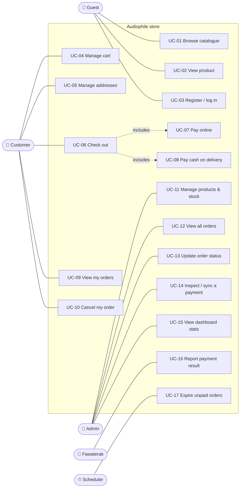

# Use cases

Who uses the system and what they can do with it. Each use case has an id (UC-xx) that the
[roadmap](roadmap.md) refers to.

## Actors

| Actor | Who | Notes |
|---|---|---|
| **Guest** | Anyone not logged in | Browses the catalogue |
| **Customer** | A registered, logged-in user | Has one cart, addresses and orders |
| **Admin** | Store staff (role `Admin`) | Manages products and orders |
| **Fawaterak** | External payment gateway | Calls our webhook |
| **Scheduler** | Background job inside the API | Expires unpaid orders |
| **Notifier** | Message consumer (Phase 6) | Sends emails when events happen |

## Use case diagram

A Customer can do everything a Guest can; the extra lines are left out to keep the diagram readable.

## Use case catalogue

Status: ✅ done · 🟡 partly done · ❌ not started

| ID | Use case | Actor | Status | Roadmap phase |
|---|---|---|---|---|
| UC-01 | Browse catalogue (search, category, price, paged) | Guest | ✅ API · UI in Phase 4 | 4, 6 |
| UC-02 | View one product | Guest | ✅ API · UI in Phase 4 | 4 |
| UC-03 | Register / log in / log out | Guest | ✅ API · UI in Phase 4 | 4 |
| UC-04 | Manage cart (add, change quantity, remove, clear) | Customer | ✅ API (uncommitted) | 0, 4 |
| UC-05 | Manage shipping addresses | Customer | ✅ API · UI in Phase 4 | 4 |
| UC-06 | Check out: turn the cart into an order | Customer | 🟡 not from cart yet | 1 |
| UC-07 | Pay online (card, wallet, Fawry/Aman) | Customer | ⏸️ built, switched off | 2 |
| UC-08 | Pay cash on delivery | Customer | ✅ | — |
| UC-09 | View my orders and their status | Customer | ✅ API | 4 (UI) |
| UC-10 | Cancel my order before it ships | Customer | 🟡 domain only | 1 |
| UC-11 | Manage products and stock | Admin | 🟡 API done · UI in Phase 5 | 5 |
| UC-12 | View and filter all orders | Admin | ❌ | 5 |
| UC-13 | Move an order along (Processing → Shipped → Delivered) | Admin | 🟡 domain only | 5 |
| UC-14 | Inspect payment events / re-sync with Fawaterak | Admin | ⏸️ built, switched off | 2, 5 |
| UC-15 | Dashboard stats (sales, orders by status, low stock) | Admin | ❌ | 5 |
| UC-16 | Report a payment result (webhook) | Fawaterak | ⏸️ built, switched off | 2 |
| UC-17 | Expire unpaid orders and release stock | Scheduler | ⏸️ built, switched off | 2 |
| UC-18 | Email the customer when an order is placed / paid / shipped | Notifier | ❌ | 6 |

---

## Detailed use cases

Only the important ones are written out in full. A detailed use case is a short story: what
must be true before, the normal path, and what can go wrong.

### UC-04 · Manage cart

**Actor:** Customer · **Before:** logged in · **After:** the cart is saved in the database (survives a refresh or another device)

**Main flow**
1. The customer adds a product with a quantity.
2. The system checks the product exists, is active and has enough stock.
3. If the product is already in the cart, the system increases that line; otherwise it adds a new line.
4. The system returns the whole cart with subtotal, shipping fee and total.

**Alternatives**
- 2a. Product doesn't exist or is inactive → **404**.
- 2b. Not enough stock → **409** "Only 3 left".
- 3a. The line would go over 100 units → **400**.

**Rule:** the cart stores only product + quantity. Prices are always today's prices.

### UC-06 · Check out

**Actor:** Customer · **Before:** cart is not empty, an address is chosen · **After:** an order exists, stock is reserved, the cart is empty

**Main flow**
1. The customer chooses an address and a payment method and presses *Place order*.
   The client sends an `Idempotency-Key` header (a new GUID per checkout attempt).
2. The system loads the cart and **re-reads every price and stock level from the database**.
3. The system decreases stock for each line (inside one transaction).
4. The system creates the order with snapshots of the address and of each line's name, price and image.
5. The system clears the cart.
6. The flow continues with **UC-07** (online) or **UC-08** (cash on delivery).

**Alternatives**
- 1a. Same `Idempotency-Key` seen before → returns the original order (**200**), creates nothing.
- 2a. Cart empty → **400**.
- 3a. Not enough stock → **409**; nothing is saved.
- 3b. Two customers buy the last unit at the same moment → exactly one succeeds; the other gets **409** (optimistic concurrency).

### UC-07 · Pay online

**Actor:** Customer, Fawaterak · **Before:** order is `Pending` with a `Pending` payment

**Main flow**
1. The system saves the order *first*, then asks the gateway to create an invoice.
2. The gateway returns a hosted checkout URL; the system returns it to the client.
3. The client redirects the customer to the gateway's page; the customer pays there.
4. The gateway calls our webhook (UC-16); the order becomes `Confirmed`.
5. The gateway redirects the customer back to *My orders*.

**Alternatives**
- 1a. Gateway down or times out → payment `Failed`, order `Cancelled`, stock released, **502/504**.
- 3a. Card declined → the customer can try another card on the same page.
- 3b. Customer never pays → UC-17 expires the order after 30 min (48 h for Fawry/Aman codes).
- 4a. Webhook lost → the admin presses *Sync* (UC-14), or UC-17 asks the gateway before expiring.

### UC-16 · Report a payment result (webhook)

**Actor:** Fawaterak · **Before:** an order with a gateway payment exists

**Main flow**
1. Fawaterak POSTs the result to `/payments/fawaterak/webhook_json`.
2. The system verifies the HMAC signature (`hashKey`). If it's invalid → **401**, nothing changes.
3. The system asks Fawaterak for the invoice to confirm it's paid and the amount is right.
4. The system records a `PaymentEvent` (unique per transaction + state).
5. Payment → `Succeeded`, order → `Confirmed`, in the same database transaction as the event.
6. Returns **200** so Fawaterak stops retrying.

**Alternatives**
- 4a. Same event seen before → **200**, nothing changes (idempotent).
- 5a. Paid amount ≠ order total → **not confirmed**, logged as critical.
- 5b. Order was already expired but the customer paid at a Fawry kiosk → payment recorded,
  order stays cancelled, flagged *needs manual refund*.

### UC-13 · Update order status

**Actor:** Admin · **Before:** logged in with role `Admin`

**Main flow**
1. The admin opens an order and chooses the next status.
2. The system checks the move is allowed by the state machine (see [diagrams](diagrams.md#order-status)).
3. The status is saved; an `OrderStatusChanged` event is published (Phase 6) and the customer is emailed.

**Alternatives**
- 2a. Illegal move (e.g. Delivered → Processing) → **409**.
